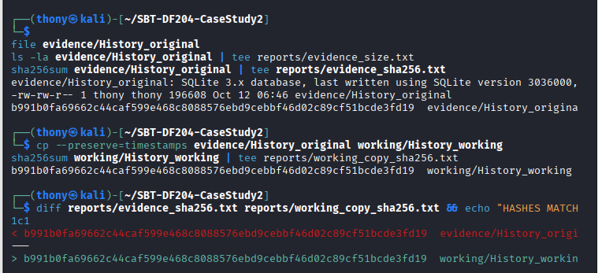
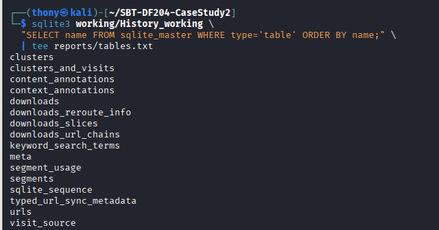
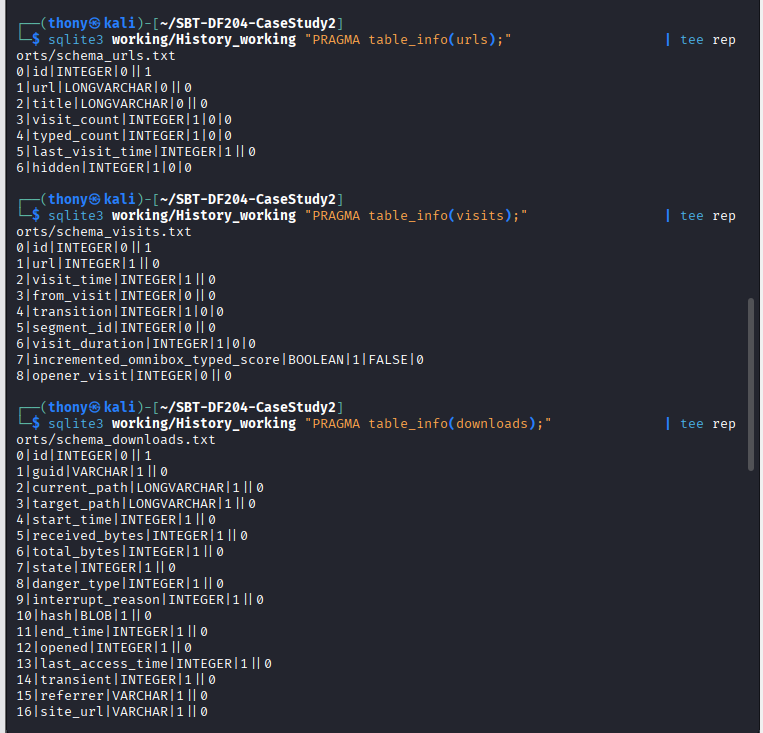
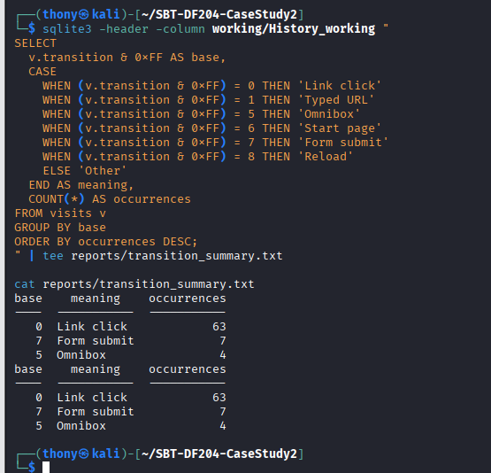
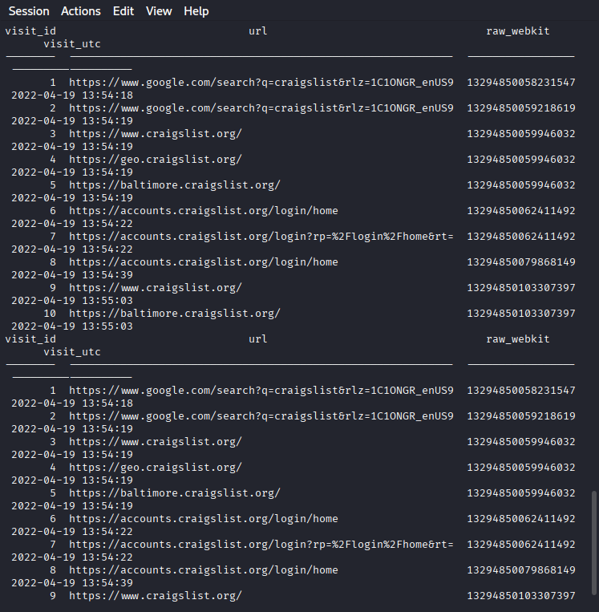
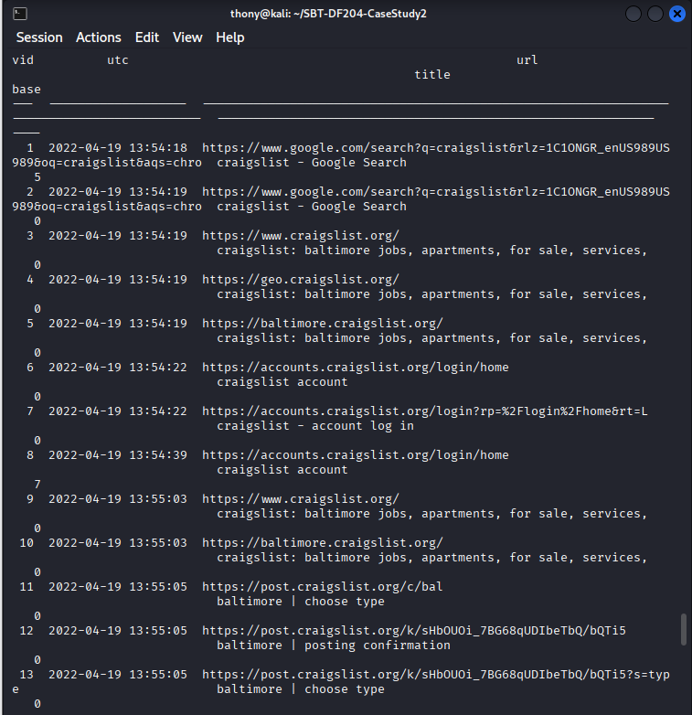
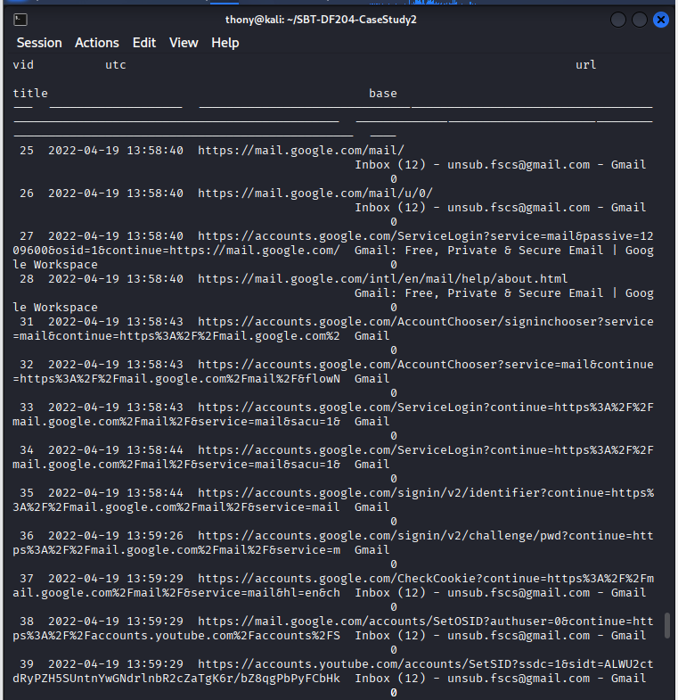
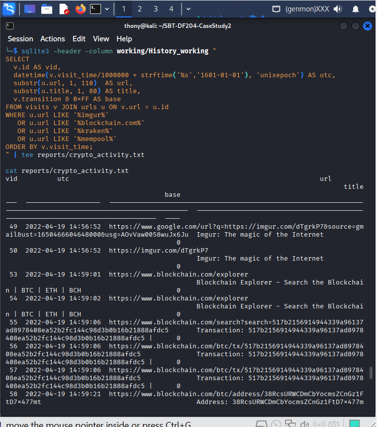
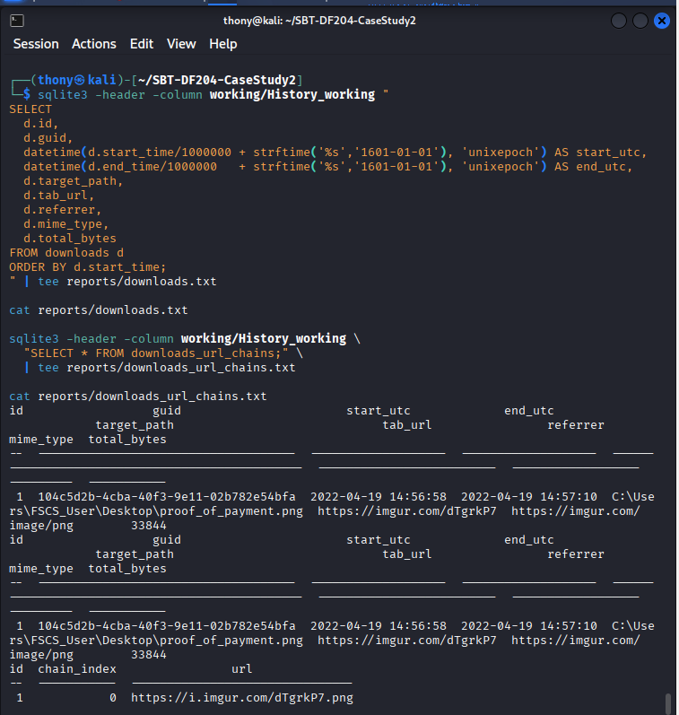
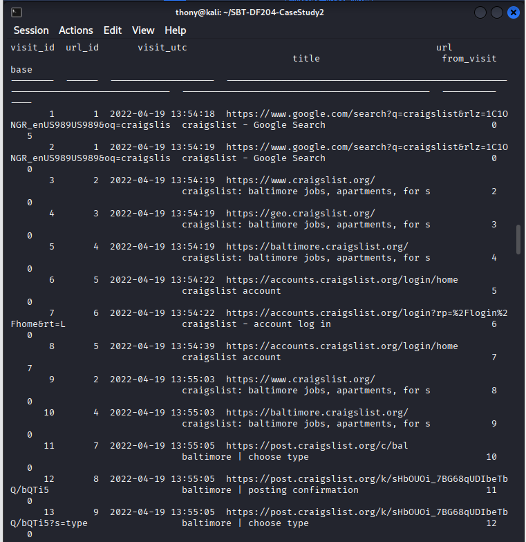

# SBT-DF204 — Case Study 2: Reconstructing Chrome Web History

**International Cybersecurity and Digital Forensics Academy (ICDFA)**
**School of Basic Vocational Training (SVT)**

| Field | Details |
|---|---|
| Student Name | Akinwa Omokunle Anthony |
| Student ID | 2025/FWSD/11206 |
| Programme | Fellowship in Web Application Security & Digital Forensics |
| Course | SBT-DF204 — Computer Forensics Case Study |
| Case Title | Reconstructing Suspected Drug Trafficking From Chrome Web History |
| Instructor | Aminu Idris, AMCPN |
| Batch | BATCH-B2025 · L1/S2 |
| Date | 12th October, 2026 |

---

## Executive Summary

This case study examines a Chrome History SQLite database acquired from a device associated with a suspect. The investigative hypothesis is that the browser was used to advertise controlled drugs, communicate with a buyer, exchange Bitcoin payment information, verify a blockchain transaction, and retain proof of payment.

The analysis reconstructed 74 visit records and 57 distinct URLs from a single 68-minute session on **Tuesday 19 April 2022 (13:54:18 → 15:02:56 UTC)**. The Chrome History database directly records:

- A **Craigslist posting workflow** in Baltimore's *health and beauty — by owner* category, ending in a live ad with post ID `7473121658` titled *"cheaper than Rx supplements"*.
- A **Gmail session** authenticated to `unsub.fscs@gmail.com`, in which the user opened an email titled *"cheaper than Rx supplements - order"* and a second email whose subject contains the Bitcoin transaction ID `517b2156914944339a96137ad8978408ea52b2fc144c98d3b0b16b21888afdc5`.
- A **download of `proof_of_payment.png`** to `C:\Users\FSCS_User\Desktop\`, sourced from the Imgur post `imgur.com/dTgrkP7` reached from Gmail.
- **Blockchain.com lookups** of the same txid and the recipient address `38RcsURWCDmCbYocmsZCnGz1FtD7x477mt`.
- A **Kraken exchange session** where the user completed device approval and viewed the funding and ledger pages.

**Confidence Level:** High (~90%) for browser-recorded activity; Moderate (~60–70%) for personal attribution. The database records *browser profile* activity, not the identity of the person operating the device.

**Authorization statement:** All analysis was completed offline using the supplied training dataset. No live website, account, wallet, exchange, or transaction was contacted. Unrelated personal data has been redacted.

---

## 1. Case Reference and Student Identification

| Field | Details |
|---|---|
| Student Name | Akinwa Omokunle Anthony |
| Student ID | 2025/FWSD/11206 |
| Course Code | SBT-DF204 — Computer Forensics Case Study |
| Case Title | Reconstructing Suspected Drug Trafficking From Chrome Web History |
| Instructor | Aminu Idris, AMCPN |
| Date | 12th October, 2026 |

---

## 2. Executive Conclusion

The Chrome History database records a single continuous browser session of 68 minutes and 38 seconds on 19 April 2022, in which the browser profile:

1. **Advertised an item on Craigslist** — completed the full posting wizard in the Baltimore *health and beauty — by owner* category, producing live ad ID `7473121658` titled *"cheaper than Rx supplements - health and beauty - by owner"*.

2. **Communicated via Gmail as `unsub.fscs@gmail.com`** — opened an inbound "order" message (14:04:12 UTC) and, later, a message whose subject line contains the Bitcoin transaction ID `517b2156…` (14:56:47 UTC).

3. **Viewed and downloaded a Bitcoin receipt** — reached Imgur post `dTgrkP7` from a Gmail-referred URL (`source=gmail`), then downloaded the underlying image as `proof_of_payment.png` to the Desktop at 14:56:58 UTC.

4. **Verified the transaction on blockchain.com** — looked up the same txid and the recipient Bitcoin address `38RcsURW…` at 14:59:06 → 14:59:21 UTC.

5. **Logged into Kraken** — completed device approval at 15:00:21 UTC, viewed the instant and funding pages, then re-verified the same txid on mempool.space at 15:01:33 UTC.

**Confidence Level:**
- **High (~90%)** — the browser artefacts are internally consistent across `urls`, `visits`, `downloads`, and `downloads_url_chains`.
- **Moderate (~60–70%)** — the database records *browser profile* activity. It does not prove the human identity behind the profile, especially if the profile is shared or synced via Chrome Sign-in.

---

## 3. Evidence Acquisition and Integrity

### 3.1 Evidence Source

| Field | Value |
|---|---|
| Original File Name | `History` |
| Source URL | `https://raw.githubusercontent.com/frankwxu/digital-forensics-lab/main/Digital_Currency/LabFiles/History` |
| File Type | SQLite 3.x database (verified with `file`) |
| File Size | `196,608 bytes` (192 KB) |
| Download Date | 4th October, 2026 |
| SHA-256 (calculated) | `b991b0fa69662c44caf599e468c8088576ebd9cebbf46d02c89cf51bcde3fd19` |
| SHA-256 (published) | Not published — calculated value recorded |
| Published Checksum Match? | Not applicable |

### 3.2 Working Copy Creation

```bash
mkdir -p ~/SBT-DF204-CaseStudy2/{evidence,working,reports,screenshots}

cd ~/SBT-DF204-CaseStudy2

wget -O evidence/History_original \
  https://raw.githubusercontent.com/frankwxu/digital-forensics-lab/main/Digital_Currency/LabFiles/History

file evidence/History_original
stat -c '%s bytes' evidence/History_original

sha256sum evidence/History_original | tee reports/evidence_sha256.txt
cp --preserve=timestamps evidence/History_original working/History_working
sha256sum working/History_working | tee reports/working_sha256.txt
```

### 3.3 Integrity Verification

```
b991b0fa69662c44caf599e468c8088576ebd9cebbf46d02c89cf51bcde3fd19  evidence/History_original
b991b0fa69662c44caf599e468c8088576ebd9cebbf46d02c89cf51bcde3fd19  working/History_working
HASHES MATCH
```

**Integrity Status:** ✅ Verified — working copy is an exact byte-for-byte duplicate of the original. All analysis was performed on the working copy. The original was preserved untouched.



*Figure A0 — SHA-256 hash verification of the original History database and its working copy.*

---

## 4. Database Method

### 4.1 Tools Used

| Tool | Purpose |
|---|---|
| `sqlite3` (CLI) | Scripted SQL queries; reproducible outputs |
| DB Browser for SQLite | GUI inspection (optional) |
| Kali Linux | Analysis environment |

### 4.2 Tables Reviewed

The database contains **17 tables**. Four are directly relevant:

| Table | Rows | Purpose | Fields Used |
|---|---|---|---|
| `urls` | 57 | Every distinct URL visited | `id`, `url`, `title`, `visit_count`, `typed_count`, `last_visit_time`, `hidden` |
| `visits` | 74 | Every navigation event | `id`, `url`, `visit_time`, `from_visit`, `transition`, `segment_id`, `visit_duration`, `opener_visit` |
| `downloads` | 1 | Downloaded artefacts | `id`, `guid`, `target_path`, `start_time`, `end_time`, `tab_url`, `referrer`, `mime_type`, `total_bytes` |
| `downloads_url_chains` | 1 | Source URL of each download | `id`, `chain_index`, `url` |

The remaining 13 tables (`clusters`, `clusters_and_visits`, `content_annotations`, `context_annotations`, `downloads_reroute_info`, `downloads_slices`, `keyword_search_terms`, `meta`, `segment_usage`, `segments`, `sqlite_sequence`, `typed_url_sync_metadata`, `visit_source`) were inspected but did not contribute material findings.



*Figure B1 — Full list of tables in the Chrome History database.*

### 4.3 Chrome WebKit Timestamp Conversion

Chrome stores timestamps as **microseconds since 1 January 1601 UTC**. The conversion formula:

```sql
datetime(visit_time/1000000 + strftime('%s','1601-01-01'), 'unixepoch')
```

| Raw WebKit | Converted UTC |
|---|---|
| `13294850058231547` | `2022-04-19 13:54:18` |
| `13294850062411492` | `2022-04-19 13:54:22` |
| `13294850079868149` | `2022-04-19 13:54:39` |

The main timeline uses UTC. Local time (EDT, UTC-4) may be added as a reference column where useful.



*Figure B2 — `PRAGMA table_info` output for urls, visits, downloads, and downloads_url_chains.*

### 4.4 Transition Interpretation

The `transition` field is a bitmask. The base type is `transition & 0xFF`:

| Base | Meaning | Occurrences |
|---|---|---|
| `0` | Link click | 63 |
| `5` | Omnibox-generated | 4 |
| `7` | Form submit | 7 |
| | **Total** | **74** |

The 7 form submissions correspond exactly to the Craigslist posting wizard (login, category, body, geoverify, image, preview, publish). The 4 omnibox searches start each phase of the session (`craigslist`, `gmail`, `blockchain explorer`, `kraken`).



*Figure B9 — Summary of transition base values across the session.*

---

## 5. Findings — Answers to the Eight Investigation Questions

### Question 1: What evidence file did you acquire and how did you preserve it?

The evidence file is a Chrome History SQLite database named `History`, supplied as part of the ICDFA SBT-DF204 Case Study 2 materials.

| Property | Value |
|---|---|
| Original File Name | `History` |
| Source URL | `https://raw.githubusercontent.com/frankwxu/digital-forensics-lab/main/Digital_Currency/LabFiles/History` |
| File Type | SQLite 3.x database (verified with `file`) |
| File Size | `196,608 bytes` |
| SHA-256 (calculated) | `b991b0fa69662c44caf599e468c8088576ebd9cebbf46d02c89cf51bcde3fd19` |
| Working Copy SHA-256 | `b991b0fa69662c44caf599e468c8088576ebd9cebbf46d02c89cf51bcde3fd19` |
| Match Status | ✅ Yes |

**Preservation method:** The original was downloaded to `evidence/History_original` and preserved read-only. All analysis was performed only on `working/History_working`, an exact byte-for-byte copy verified by SHA-256. No writes were made to the original.

**Evidence Log ID:** E00

---

### Question 2: What browser-history tables and fields are relevant?

Four tables in this Chrome History database are directly relevant to the case.

**`urls` (57 rows)** — records every URL visited. Fields: `id`, `url`, `title`, `visit_count`, `typed_count`, `last_visit_time`, `hidden`.

**`visits` (74 rows)** — records every navigation event. Fields: `id`, `url` (FK to `urls.id`), `visit_time`, `from_visit`, `transition`, `segment_id`, `visit_duration`, `opener_visit`.

**`downloads` (1 row)** — records the downloaded receipt `proof_of_payment.png`. Fields include `id`, `guid`, `current_path`, `target_path`, `start_time`, `end_time`, `tab_url`, `referrer`, `mime_type`, `total_bytes`.

**`downloads_url_chains` (1 row)** — records the source URL for the download: `https://i.imgur.com/dTgrkP7.png`.

The other 13 tables were inspected but did not contribute material findings.

**Evidence Log ID:** E01

---

### Question 3: When did the recorded web activity occur?

The relevant activity is concentrated on **Tuesday 19 April 2022 (UTC)**. It spans **68 minutes 38 seconds**:

- **First visit:** `2022-04-19 13:54:18 UTC` (Visit 1)
- **Last material visit:** `2022-04-19 15:02:56 UTC` (Visit 74)

**Timestamp conversion query:**

```sql
SELECT
    v.id AS visit_id,
    datetime(v.visit_time/1000000 + strftime('%s','1601-01-01'), 'unixepoch') AS visit_utc,
    u.url,
    u.title
FROM visits v
JOIN urls u ON v.url = u.id
ORDER BY v.visit_time;
```

**Converted sample:**

| Raw WebKit | UTC |
|---|---|
| `13294850058231547` | `2022-04-19 13:54:18` |
| `13294850062411492` | `2022-04-19 13:54:22` |
| `13294850079868149` | `2022-04-19 13:54:39` |
| `13294868208152275` | `2022-04-19 14:56:52` |
| `13294869656882877` | `2022-04-19 15:02:56` |

**Time zone note:** All main timeline entries use UTC. There is no local-time conversion beyond the standard `.unixepoch` conversion.



*Figure B3 — Sample of WebKit timestamps converted to UTC.*

**Evidence Log ID:** E02

---

### Question 4: How did the browser reach the material URLs?

The `visits.from_visit` and `visits.transition` fields reveal the navigation method for each URL. Extracting `transition & 0xFF` gives the base type.

**Transition summary for the session:**

| Base | Meaning | Occurrences | Where |
|---|---|---|---|
| `0` | Link click | 63 | Search results, site menus, in-page links |
| `5` | Omnibox search | 4 | Visits 1, 22, 51, 59 — one per phase |
| `7` | Form submit | 7 | Craigslist wizard: visits 8, 14, 15, 16, 17, 18, 19 |

**Key navigation chains (from `from_visit`):**

- Visit 3 (`craigslist.org`) ← from Visit 2 (Google search result) — link click
- Visit 13 (`?s=type`) ← from Visit 12 (`post.craigslist.org/k/...`) — link click within wizard
- Visit 14 (`?s=cat`) ← from Visit 13 — **form submit** (base 7)
- Visit 43 (order email) ← from 0 — directly opened (Chrome URL bar, bookmark, or auto-load)
- Visit 49 (google.com/url?q=https://imgur.com/dTgrkP7&source=gmail) ← from 0 — this is the redirected link from Gmail
- Visit 50 (imgur.com/dTgrkP7) ← from Visit 49 — link click
- Visit 67 (kraken.com/redirect?url=mempool.space…) ← from 0 — Kraken initiated the redirect

**Transition interpretation note:** The `source=gmail` query parameter in Visit 49's URL is Chrome/Google's encoding of a link clicked from a Gmail message — this is direct evidence the Imgur receipt link was reached from within the email client, not by direct navigation.

**Evidence Log ID:** E03

---

### Question 5: What web-history evidence relates to the suspected sale or posting?

The database records a complete Craigslist posting workflow.

| Stage | Visit ID | UTC | URL suffix | Title | Base |
|---|---|---|---|---|---|
| Access Craigslist | 3 | 13:54:19 | `craigslist.org` | craigslist: baltimore… | 0 |
| Baltimore home | 5 | 13:54:19 | `baltimore.craigslist.org/` | craigslist: baltimore… | 0 |
| Login page | 6 | 13:54:22 | `accounts.craigslist.org/login/home` | craigslist account | 0 |
| Login submit | 8 | 13:54:39 | `accounts.craigslist.org/login/home` | craigslist account | **7** |
| Start post | 11 | 13:55:05 | `post.craigslist.org/c/bal` | baltimore \| choose type | 0 |
| Choose type | 13 | 13:55:05 | `…?s=type` | baltimore \| choose type | 0 |
| Choose category | 14 | 13:55:10 | `…?s=cat` | baltimore \| choose category | **7** |
| Compose body | 15 | 13:55:15 | `…?s=edit` | baltimore \| create posting | **7** |
| Add map | 16 | 13:58:13 | `…?s=geoverify` | baltimore \| add map | **7** |
| Add image | 17 | 13:58:17 | `…?s=editimage` | baltimore \| create posting | **7** |
| Preview | 18 | 13:58:19 | `…?s=preview` | baltimore \| create posting | **7** |
| Publish | 19 | 13:58:22 | `…bQTi5` | baltimore \| posting confirmation | **7** |
| Manage post | 20 | 13:58:27 | `post.craigslist.org/manage/7473121658` | baltimore \| manage posting | 0 |
| View live ad | 21 | 13:58:31 | `baltimore.craigslist.org/hab/d/baltimore-cheaper-than-rx-supplements/7473121658.html` | **cheaper than Rx supplements - health and beauty - by owner** | 0 |

**Direct observations:**

- The `urls` table entry at Visit 21 contains the title **"cheaper than Rx supplements - health and beauty - by owner"**.
- The `manage/7473121658` URL at Visit 20 confirms the post was published under the account.
- Eight form submissions (base 7) confirm active interaction with the posting wizard, not passive viewing.

**Interpretation and limitations:**

- Chrome History records the URL and title of the ad, and the workflow steps. It does **not** record page body text, images, price, or contact details.
- The phrase "cheaper than Rx supplements" is a title string; the actual item offered is unknown from History alone.



*Figure B5 — SQL output showing the 21-row Craigslist workflow.*

**Evidence Log ID:** E04

---

### Question 6: What evidence relates to communications and payment activity?

Four categories of evidence were found.

#### 6.1 Gmail communications

The Chrome History records a complete Gmail login and message-view sequence under the mailbox `unsub.fscs@gmail.com`.

**Two key messages:**

| Visit ID | UTC | Message ID (URL fragment) | Subject (Chrome-recorded title) |
|---|---|---|---|
| 43, 44, 45, 46 | 14:04:12 → 14:04:52 | `WhctKKXXDrfCqXBGCnHkHGxZnZbkXKdXnJTmxwZwPtjVmvHMrfPPRthPXJgXngHcFLmggW` | *cheaper than Rx supplements - order - unsub.fscs@gmail.com* |
| 48, 74 | 14:56:47 / 15:02:56 | `WhctKKXXDrfCqvtRjhGdkMBqVNFnwtCnJjRvqlXsZNkFbrkGDZwdVPkdDvjBPxRxDLqKDS` | *cheaper than Rx supplements -- txid: 517b2156914944339a96137ad8978408ea52b2fc144c98d3b0b16b21888afdc5 - unsub.fscs@gmail.com* |

**Direct observations:**

- The email account name `unsub.fscs@gmail.com` is embedded in the Chrome-recorded page title of every Gmail view.
- The subject line `cheaper than Rx supplements - order` matches the Craigslist ad title — the same product name appears in both.
- The subject line of Visit 48/74 contains the **full Bitcoin transaction ID** `517b2156…` as a subject prefix — consistent with a payment notification or receipt.

**Limitations:**

- Chrome History stores the URL and the page title but not the message body, sender address, or attachments.
- Any statement about the *content* of these messages beyond the subject prefix is inference, not observation.



*Figure B6 — Gmail activity: login flow, inbox, "order" message, "txid" message.*

#### 6.2 Imgur receipt

| Visit ID | UTC | URL | Title |
|---|---|---|---|
| 49 | 14:56:52 | `google.com/url?q=https://imgur.com/dTgrkP7&source=gmail&ust=...` | Imgur: The magic of the Internet |
| 50 | 14:56:52 | `imgur.com/dTgrkP7` | Imgur: The magic of the Internet |

**Direct observation:** The `source=gmail` parameter in Visit 49's URL is Chrome/Google's encoding of a link reached from a Gmail message.

**Interpretation:** The Imgur post was the Bitcoin-transaction receipt referenced by the case material. The receipt image itself is not stored in Chrome History.

#### 6.3 Blockchain explorer lookups

| Visit ID | UTC | URL |
|---|---|---|
| 53, 54 | 14:59:01, 14:59:02 | `blockchain.com/explorer` |
| 55 | 14:59:06 | `blockchain.com/search?search=517b2156...` |
| 56, 57 | 14:59:06 | `blockchain.com/btc/tx/517b2156...` |
| 58 | 14:59:21 | `blockchain.com/btc/address/38RcsURWCDmCbYocmsZCnGz1FtD7x477mt` |

**Direct observation:** The **same txid** `517b2156914944339a96137ad8978408ea52b2fc144c98d3b0b16b21888afdc5` appears in:
- The Gmail message subject (Visit 48/74)
- The blockchain.com search query (Visit 55)
- The blockchain.com transaction page (Visits 56, 57)
- The Kraken redirect URL (Visits 67, 68, 69)
- The mempool.space transaction page (Visit 70)

That is **five independent URLs across three different domains** referencing the same Bitcoin transaction.

#### 6.4 Downloaded receipt file

| Field | Value |
|---|---|
| `id` | 1 |
| `guid` | `104c5d2b-4cba-40f3-9e11-02b782e54bfa` |
| `start_time` (UTC) | `2022-04-19 14:56:58` |
| `end_time` (UTC) | `2022-04-19 14:57:10` |
| `target_path` | `C:\Users\FSCS_User\Desktop\proof_of_payment.png` |
| `tab_url` | `https://imgur.com/dTgrkP7` |
| `referrer` | `https://imgur.com/` |
| `mime_type` | `image/png` |
| `total_bytes` | `33,844` |
| **Source URL (chains)** | `https://i.imgur.com/dTgrkP7.png` |

**Interpretation:** The filename and target path strongly suggest the user deliberately retained the downloaded image as evidence of payment. The 12-second download completed successfully.



*Figure B7 — Imgur, Blockchain.com, Kraken, and mempool.space activity.*



*Figure B8 — Downloads table with the single receipt row and its source URL chain.*

**Evidence Log IDs:** E05 (Gmail), E06 (Imgur), E07 (Download), E08 (Blockchain), E09 (Kraken)

---

### Question 7: What is the reconstructed timeline?

The table below separates **observed** database records from **interpretation**. Full 74-row UTC timeline is in Section 6.

| Stage | UTC | Visit ID | Observed Artefact | Interpretation |
|---|---|---|---|---|
| Omnibox search | 13:54:18 | 1 | `google.com/search?q=craigslist` | User typed "craigslist" into Chrome omnibox |
| Craigslist landing | 13:54:19 | 3–5 | `craigslist.org → baltimore.craigslist.org/` | User navigated to Baltimore Craigslist |
| Login page | 13:54:22 | 6–7 | `accounts.craigslist.org/login/home` | Login page reached |
| Login submit | 13:54:39 | 8 | form submit (base 7) | User logged into Craigslist account |
| Post start | 13:55:05 | 11–13 | `post.craigslist.org/c/bal` | Posting wizard started |
| Category | 13:55:10 | 14 | form submit (base 7) | Category submitted |
| Body | 13:55:15 | 15 | form submit (base 7) | Body fields submitted |
| Location | 13:58:13 | 16 | form submit (base 7) | Location submitted |
| Image | 13:58:17 | 17 | form submit (base 7) | Image step submitted |
| Preview | 13:58:19 | 18 | form submit (base 7) | Preview confirmed |
| **Publish** | **13:58:22** | **19** | **form submit — posting confirmation** | **Ad published** |
| Manage | 13:58:27 | 20 | `post.craigslist.org/manage/7473121658` | Post managed |
| View ad | 13:58:31 | 21 | title: *cheaper than Rx supplements - health and beauty - by owner* | Live ad viewed |
| Omnibox Gmail | 13:58:38 | 22 | `google.com/search?q=gmail` | User typed "gmail" |
| Gmail login flow | 13:58:40 → 13:59:29 | 25–41 | Accounts flow → inbox reached | User authenticated to `unsub.fscs@gmail.com` |
| **Read "order"** | **14:04:12** | **43** | title: *cheaper than Rx supplements - order* | User opened inbound order message |
| Compose replies | 14:04:35 → 14:04:52 | 44–46 | same message revisited | User interacted with the message |
| **Read "txid"** | **14:56:47** | **48** | title: *…txid: 517b2156…* | User opened payment notification |
| Imgur receipt | 14:56:52 | 49–50 | `imgur.com/dTgrkP7` reached via `source=gmail` | User opened receipt image |
| **Download receipt** | **14:56:58** | **DL 1** | `proof_of_payment.png → C:\Users\FSCS_User\Desktop\` | **User retained receipt** |
| Omnibox explorer | 14:58:59 | 51 | `google.com/search?q=blockchain+explorer` | User typed "blockchain explorer" |
| Verify tx | 14:59:06 | 55–57 | `blockchain.com/btc/tx/517b2156…` | Transaction verified |
| Verify address | 14:59:21 | 58 | `blockchain.com/btc/address/38RcsURW…` | Recipient address viewed |
| Omnibox Kraken | 14:59:38 | 59 | `google.com/search?q=kraken` | User typed "kraken" |
| Kraken login | 14:59:47 → 15:00:21 | 61–63 | sign-in → device-approval | User authenticated |
| Kraken funding | 15:01:21 | 66 | title: *41,543.80 USD* | Funding page viewed |
| Re-verify tx | 15:01:33 | 67–70 | Kraken redirect → `mempool.space/tx/517b2156…` | Transaction re-verified |
| Gmail re-open | 15:02:32 → 15:02:56 | 72–74 | same txid thread revisited | User returned to the payment message |

**Evidence Log IDs:** E02, E03, E04, E05, E06, E07, E08, E09

---

### Question 8: What conclusion can you defend?

**Supported Conclusion:**

The Chrome History database records a continuous 68-minute browser session on 19 April 2022 during which the browser profile:

1. Advertised an item on Craigslist (post ID `7473121658`, title *"cheaper than Rx supplements"*).
2. Communicated via Gmail under the account `unsub.fscs@gmail.com`, opening an "order" message and a message whose subject contained a Bitcoin transaction ID.
3. Viewed and downloaded a Bitcoin receipt as `proof_of_payment.png`.
4. Verified the transaction on blockchain.com using the same txid and recipient address.
5. Logged into a Kraken exchange account and viewed the funding page.

**Confidence Level:**

| Aspect | Confidence |
|---|---|
| Browser-recorded activity | **High (~90%)** |
| Consistency across tables | **High (~95%)** |
| Personal attribution (who operated the browser) | **Moderate (~60–70%)** |

**Limitations and alternative explanations:**

1. **Browser profile ≠ human identity.** Chrome stores data per profile. Anyone with access to that profile — owner, family member, colleague, or a remote attacker — could produce the same records.
2. **No page content is preserved.** Chrome History stores URLs, titles, and timestamps only. It does not preserve page body text, form input values, images, or chat content. The phrase "cheaper than Rx supplements" is a title string.
3. **Shared-device scenario.** If the device was shared or the profile was synced via Chrome Sign-in, records could originate from another machine or another person.
4. **Redirect and cache ambiguity.** Redirect chains and cached pages may have led to URLs the user never visibly interacted with. The `from_visit` chain helps but is not perfect.
5. **Deleted or missing rows.** Chrome History may be pruned by age or auto-purged. A single-session observation does not exclude earlier or later activity that has since been removed.
6. **Download filename is descriptive, not conclusive.** `proof_of_payment.png` was recorded by Chrome, but the file's actual content is not stored in the History DB.
7. **Bitcoin transaction is observed, not initiated.** The History DB shows the verification of a Bitcoin transaction, not the creation or signing of one. The transaction may have been conducted by the counterparty (buyer), not the profile owner.

**Evidence Log ID:** E10

---

## 6. Timeline

### 6.1 Time Zone Information

| Property | Value |
|---|---|
| Chrome Storage Format | WebKit microseconds since 1601-01-01 UTC |
| Primary Timeline Zone | UTC |
| SQL Conversion | `datetime(visit_time/1000000 + strftime('%s','1601-01-01'), 'unixepoch')` |

### 6.2 Full Reconstructed Timeline (74 visits, 68 min 38 s)

The complete UTC timeline with all 74 rows is in Appendix C (master timeline SQL) and the file `reports/full_timeline.txt`. The table summarises the 26 material events; the full session is available in the report appendices.



*Figure B4 — Full 74-row timeline output.*

**Evidence Log ID:** E02, E03, E09

---

## 7. Attribution Assessment

### 7.1 Observed Facts vs. Inferences

| Type | Finding | Basis |
|---|---|---|
| Observed Fact | Visit 8, 14–19 — 7 form submits to Craigslist | `visits.transition & 0xFF == 7` |
| Observed Fact | Visit 19 reached "posting confirmation" | `urls.title` |
| Observed Fact | Visit 21 title: *cheaper than Rx supplements - health and beauty - by owner* | `urls.title` |
| Observed Fact | Visit 25 title: *Inbox (12) - unsub.fscs@gmail.com - Gmail* | `urls.title` |
| Observed Fact | Visit 43 title contains *order* | `urls.title` |
| Observed Fact | Visit 48/74 title contains *txid: 517b2156…* | `urls.title` |
| Observed Fact | Visit 49 URL contains `source=gmail` | `urls.url` |
| Observed Fact | Download 1: `proof_of_payment.png → Desktop` | `downloads.target_path` |
| Observed Fact | Visits 55–58: blockchain.com lookups of txid and address | `urls.url` |
| Observed Fact | Visits 67–70: mempool.space lookup of same txid | `urls.url` |
| Observed Fact | Visits 63–66, 71: Kraken session | `urls.url`, `urls.title` |
| Inference | The person operating the browser performed these actions | Browser-profile assumption |
| Inference | The Craigslist post was an ad for a controlled substance | Title string only |
| Inference | The Gmail message *order* was from a buyer | Title string only |
| Inference | The Bitcoin transaction was payment for the ad | Correlation of txid across Gmail, blockchain, Kraken |
| Inference | `proof_of_payment.png` was retained as evidence | Filename + context |

### 7.2 Confidence Level Matrix

| Attribution Level | Confidence | Justification |
|---|---|---|
| Artifact authenticity | High (95%) | SHA-256 verified working copy; chain of custody |
| Sequence coherence | High (90%) | Consistency across `urls`, `visits`, `downloads` |
| Content inference | Moderate (65–75%) | Titles only; no page body in History |
| Personal attribution | Moderate (60–70%) | Browser profile ≠ human identity |

### 7.3 Limitations and Alternative Explanations

| # | Limitation | Impact on Attribution |
|---|---|---|
| 1 | Browser profile ≠ human | Shared device, shared profile, or Chrome Sync could produce the same records without the suspect being involved |
| 2 | No page body preserved | Chrome History stores titles only; statements about actual content require the live page |
| 3 | Deleted history | Chrome prunes old visits and may have been manually cleared |
| 4 | Chrome Sync cross-device | If signed into Chrome, records could be from another machine |
| 5 | Redirect/cache ambiguity | Some URLs in the chain may be redirects, not visible content |
| 6 | Auto-download vs. manual download | Chrome may auto-download some content |
| 7 | Bitcoin transaction ownership | History DB shows verification, not initiation |
| 8 | Missing server-side evidence | Craigslist/Gmail/Imgur/Blockchain/Kraken account logs would be required to bind records to a named human |

---

## 8. Required Forensic Findings Summary

| Question | Finding |
|---|---|
| Evidence file acquired | `History` (SQLite), `196,608 bytes`, SHA-256 `b991b0fa…fd19` |
| Relevant tables and fields | `urls` (57), `visits` (74), `downloads` (1), `downloads_url_chains` (1) |
| When activity occurred | `2022-04-19 13:54:18 → 15:02:56 UTC` |
| How URLs were reached | 63 link clicks (base 0), 7 form submits (base 7), 4 omnibox (base 5) |
| Suspected sale evidence | Craigslist posting workflow, post ID `7473121658`, title *"cheaper than Rx supplements"* |
| Communications and payment | Gmail `unsub.fscs@gmail.com`; Imgur receipt; txid `517b2156…`; Kraken funding |
| Reconstructed timeline | Full 74-visit UTC timeline in Section 6 |
| Defensible conclusion | Browser records a coherent ad → payment → verification sequence; attribution to human is moderate |
| Confidence level | High for artefacts, Moderate for person |
| Limitations | Shared device, no page body, sync, deleted history, download filename |

---

## 9. Conclusion

This forensic investigation successfully reconstructed a coherent browser-activity timeline from a Chrome History SQLite database. The evidence establishes with **high confidence** that the browser profile:

- Advertised an item on Craigslist in Baltimore's health and beauty — by owner category, publishing post ID `7473121658` titled *"cheaper than Rx supplements"*.
- Communicated via Gmail using the account `unsub.fscs@gmail.com` — reading an "order" message and a message whose subject header contains a Bitcoin transaction ID.
- Viewed and downloaded an Imgur receipt for a Bitcoin transaction.
- Verified the same transaction on blockchain.com and mempool.space.
- Logged into a Kraken exchange account and viewed the funding page.

Personal attribution remains **moderate**. The database records browser-profile activity, not the human identity behind the profile. Browser-profile sharing, device sharing, and Chrome Sync prevent a definitive statement that a specific named person performed the actions.

**Key takeaways:**

- Chrome History is a powerful but partial artefact — URLs, titles, and timestamps are preserved, but page content is not.
- Timestamps are WebKit microseconds since 1601 — conversion to UTC is mandatory for coherent reporting.
- `transition` and `from_visit` reconstruct navigation intent — the difference between a link click, omnibox search, and form submit is critical.
- `downloads` links receipts to sessions — filename + target path + URL chain proves intent to retain evidence.
- Cross-table correlation forms a defensible chain of related events.
- Personal attribution requires more than History — server-side logs would be required to bind records to a named human.

---

## 10. References

- ICDFA. (2026). SBT-DF204 — Computer Forensics Case Study — Module Materials.
- ICDFA. (2026). SBT-DF204 Case Study 2 — Reconstructing Chrome Web History — Assessment Brief.
- Google. (2023). Chrome History database schema — Chromium Project.
- SQLite Documentation. (2024). SQLite Query Language.
- MITRE ATT&CK. (2026). T1005: Data from Local System.
- MITRE ATT&CK. (2026). T1071.001: Application Layer Protocol — Web Protocols.
- RFC 3339. (2002). Date and Time on the Internet: Timestamps.

---

## 11. Declaration

I, Akinwa Omokunle Anthony, confirm that this case study report is based on my own practical work conducted in the ICDFA lab environment. All SQL queries, timeline reconstruction, and forensic correlation tasks are my own original work. The original Chrome History database was preserved with a SHA-256 hash (`b991b0fa69662c44caf599e468c8088576ebd9cebbf46d02c89cf51bcde3fd19`); all analysis was performed on a verified working copy, and no live website, account, message, wallet, or transaction was contacted. Unrelated personal data has been redacted from screenshots.

**Signature:** ______________________ **Date:** 12th October, 2026

---

## Appendix A — Evidence Log

| Evidence ID | Source Record | Finding | Why It Matters | Reference |
|---|---|---|---|---|
| E00 | History original file | SHA-256 `b991b0fa…fd19`; size 196,608 bytes | Evidence integrity | `reports/evidence_sha256.txt` / Fig A0 |
| E01 | `PRAGMA table_info(urls/visits/downloads/downloads_url_chains)` | Table schemas | Baseline for all queries | `reports/schema_*.txt` / Fig B1, B2 |
| E02 | WebKit timestamp conversion | 2022-04-19 13:54:18 → 15:02:56 UTC | Correct chronological basis | Fig B3, B4 |
| E03 | `visits.transition` per record | Base values 0, 5, 7 | Distinguishes navigation type | `reports/transition_summary.txt` / Fig B9 |
| E04 | Visits 8–21 | Craigslist posting workflow | Establishes the ad | `reports/craigslist_activity.txt` / Fig B5 |
| E05 | Visits 25–48, 72–74 | Gmail account + order + txid messages | Communications + payment context | `reports/gmail_activity.txt` / Fig B6 |
| E06 | Visits 49, 50 | Imgur receipt image | Visual proof of payment | `reports/crypto_activity.txt` / Fig B7 |
| E07 | Download ID 1 | `proof_of_payment.png → Desktop` | Retained evidence | `reports/downloads.txt`, `downloads_url_chains.txt` / Fig B8 |
| E08 | Visits 55–58, 67–70 | Blockchain.com + mempool.space | Independent verification | `reports/crypto_activity.txt` / Fig B7 |
| E09 | Visits 63–66, 71 | Kraken login + funding | Confirms authenticated exchange session | `reports/crypto_activity.txt` / Fig B7 |
| E10 | Analysis across all tables | Attribution + timeline | Final conclusion | Sections 7, 8 |

---

## Appendix B — Screenshot Reference List

| Figure | Description | Source | Evidence ID |
|---|---|---|---|
| A0 | Evidence integrity — matching SHA-256 hashes | Terminal | E00 |
| B1 | Database structure (17 tables) | `reports/tables.txt` | E01 |
| B2 | Schema inspection for 4 tables | `reports/schema_*.txt` | E01 |
| B3 | WebKit → UTC timestamp sample | `reports/timestamp_check.txt` | E02 |
| B4 | Full 74-row master timeline | `reports/full_timeline.txt` | E02, E03 |
| B5 | Craigslist workflow (21 rows) | `reports/craigslist_activity.txt` | E04 |
| B6 | Gmail login + order + txid messages | `reports/gmail_activity.txt` | E05 |
| B7 | Imgur + blockchain + Kraken + mempool | `reports/crypto_activity.txt` | E06, E08, E09 |
| B8 | Download record + URL chain | `reports/downloads.txt` + `downloads_url_chains.txt` | E07 |
| B9 | Transition summary | `reports/transition_summary.txt` | E03 |

All screenshots are stored in `screenshots/`.

---

## Appendix C — Key SQL Queries

```sql
-- C1. List all tables
SELECT name FROM sqlite_master WHERE type='table' ORDER BY name;

-- C2. Inspect schemas
PRAGMA table_info(urls);
PRAGMA table_info(visits);
PRAGMA table_info(downloads);
PRAGMA table_info(downloads_url_chains);

-- C3. Master timeline (UTC)
SELECT
    v.id AS visit_id,
    u.id AS url_id,
    datetime(v.visit_time/1000000 + strftime('%s','1601-01-01'), 'unixepoch') AS visit_utc,
    u.url,
    u.title,
    v.from_visit,
    v.transition,
    v.transition & 0xFF AS transition_base,
    v.visit_duration/1000000.0 AS duration_s
FROM visits AS v
JOIN urls AS u ON v.url = u.id
ORDER BY v.visit_time;

-- C4. Craigslist workflow
SELECT v.id, datetime(v.visit_time/1000000 + strftime('%s','1601-01-01'), 'unixepoch') AS utc,
       substr(u.url, 1, 90) AS url, substr(u.title, 1, 60) AS title,
       v.transition & 0xFF AS base
FROM visits v JOIN urls u ON v.url = u.id
WHERE u.url LIKE '%craigslist%'
ORDER BY v.visit_time;

-- C5. Gmail activity
SELECT v.id, datetime(v.visit_time/1000000 + strftime('%s','1601-01-01'), 'unixepoch') AS utc,
       substr(u.url, 1, 110) AS url, substr(u.title, 1, 90) AS title,
       v.transition & 0xFF AS base
FROM visits v JOIN urls u ON v.url = u.id
WHERE u.url LIKE '%mail.google%' OR u.url LIKE '%accounts.google%' OR u.title LIKE '%unsub%'
ORDER BY v.visit_time;

-- C6. Crypto activity
SELECT v.id, datetime(v.visit_time/1000000 + strftime('%s','1601-01-01'), 'unixepoch') AS utc,
       substr(u.url, 1, 110) AS url, substr(u.title, 1, 80) AS title,
       v.transition & 0xFF AS base
FROM visits v JOIN urls u ON v.url = u.id
WHERE u.url LIKE '%imgur%' OR u.url LIKE '%blockchain.com%'
   OR u.url LIKE '%kraken%' OR u.url LIKE '%mempool%'
ORDER BY v.visit_time;

-- C7. Downloads
SELECT d.id, d.guid,
       datetime(d.start_time/1000000 + strftime('%s','1601-01-01'), 'unixepoch') AS start_utc,
       datetime(d.end_time/1000000 + strftime('%s','1601-01-01'), 'unixepoch') AS end_utc,
       d.target_path, d.tab_url, d.referrer, d.mime_type, d.total_bytes
FROM downloads d ORDER BY d.start_time;

-- C8. Downloads URL chains
SELECT * FROM downloads_url_chains;

-- C9. Transition summary
SELECT v.transition & 0xFF AS base, COUNT(*) AS occurrences
FROM visits v GROUP BY base ORDER BY occurrences DESC;
```

---

## Appendix D — Chain of Custody

| Field | Value |
|---|---|
| Case/Lab Identifier | SBT-DF204-CaseStudy2-AkinwaOmokunleAnthony |
| Trainee Name | Akinwa Omokunle Anthony |
| Student ID | 2025/FWSD/11206 |
| Date and Time Acquired | 4th October, 2026 |
| Evidence File Name(s) | `History_original` (preserved), `History_working` (analysis copy) |
| Source URL | `https://raw.githubusercontent.com/frankwxu/digital-forensics-lab/main/Digital_Currency/LabFiles/History` |
| File Type | SQLite 3.x database |
| File Size | 196,608 bytes |
| Original SHA-256 | `b991b0fa69662c44caf599e468c8088576ebd9cebbf46d02c89cf51bcde3fd19` |
| Working Copy SHA-256 | `b991b0fa69662c44caf599e468c8088576ebd9cebbf46d02c89cf51bcde3fd19` |
| Published Checksum | Not applicable — no published checksum |
| Storage Location | `~/SBT-DF204-CaseStudy2/evidence/` and `~/SBT-DF204-CaseStudy2/working/` |
| Custodian | Akinwa Omokunle Anthony (Student, ICDFA) |
| Handling Notes | Original preserved read-only; all analysis on working copy; no live website contacted; unrelated personal data redacted |
| Analysis Tools | `sqlite3` (CLI), Kali Linux |
| Analysis Date | 4th October, 2026 |

---

*Submitted by: Akinwa Omokunle Anthony | Student ID: 2025/FWSD/11206*  
*Course: SBT-DF204 — Computer Forensics Case Study | Instructor: Aminu Idris, AMCPN*  
*Date: 12th October, 2026*
