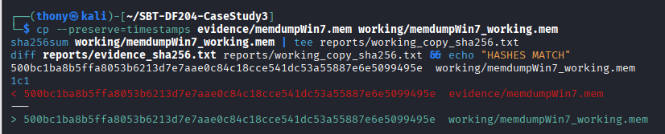
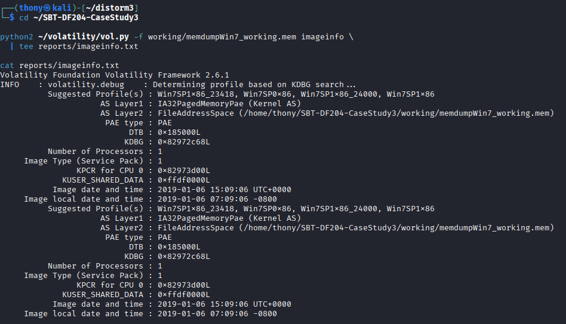
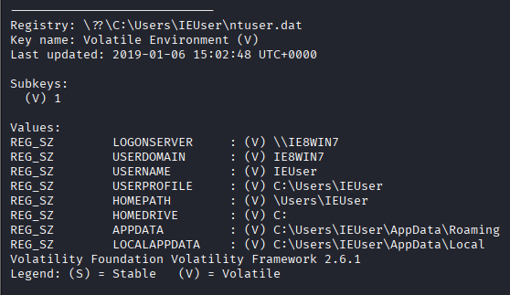
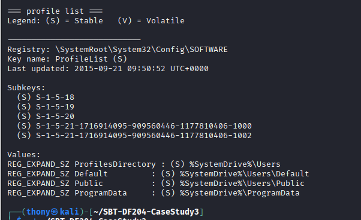
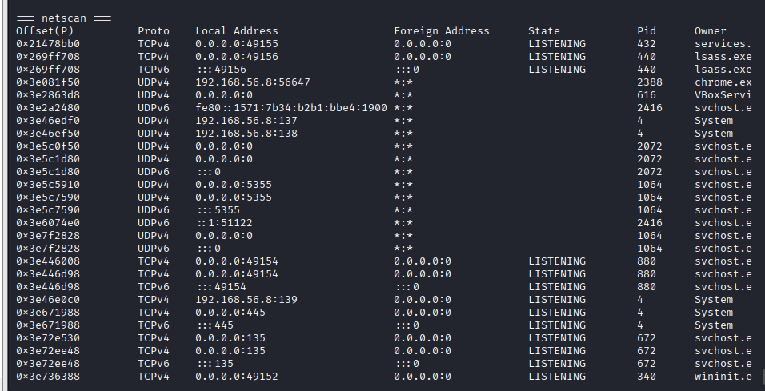
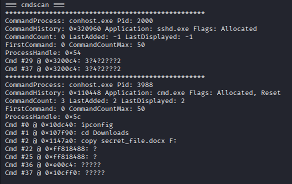
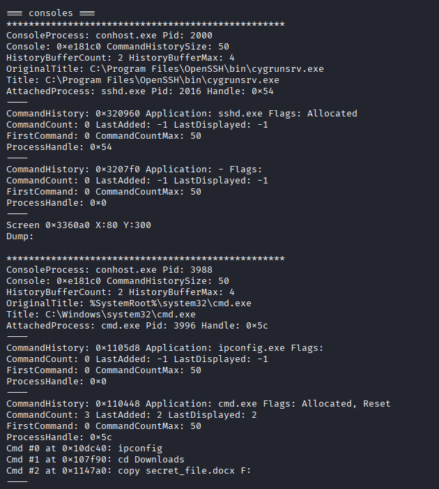
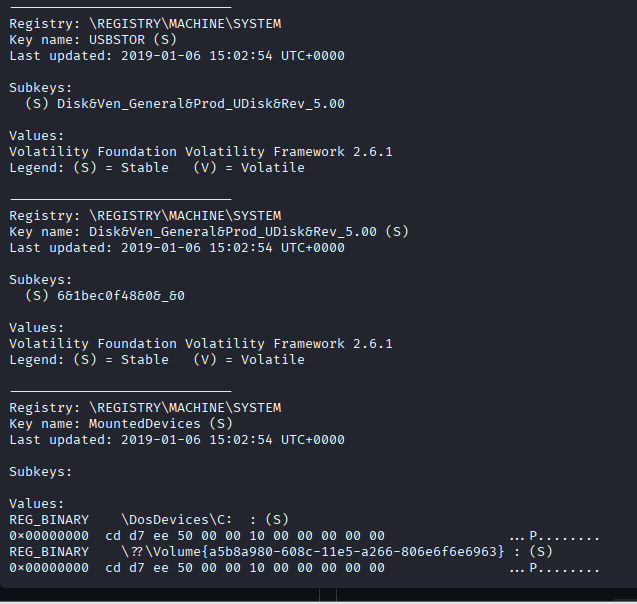
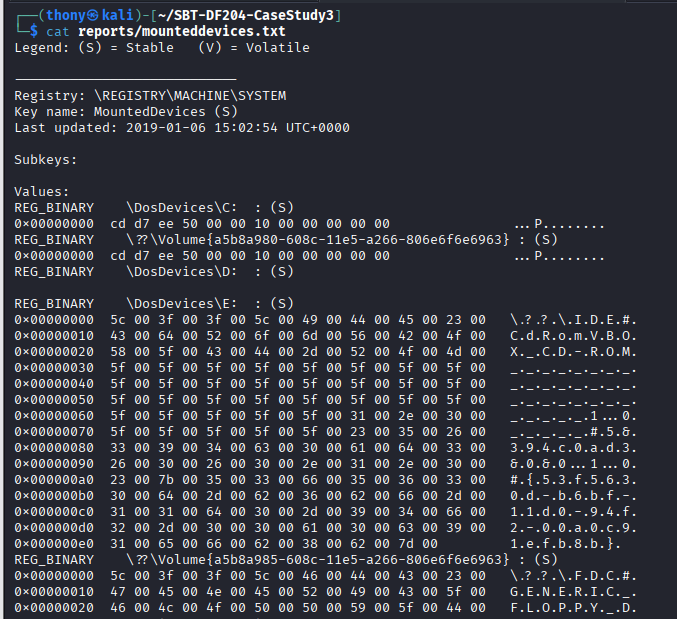
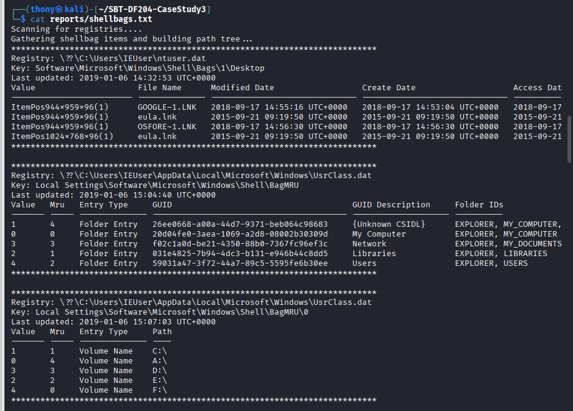

# SBT-DF204 — Case Study 3: Investigating Memory Evidence

**International Cybersecurity and Digital Forensics Academy (ICDFA)**
**School of Basic Vocational Training (SVT)**

| Field | Details |
|---|---|
| Student Name | Akinwa Omokunle Anthony |
| Student ID | 2025/FWSD/11206 |
| Programme | Fellowship in Web Application Security & Digital Forensics |
| Course | SBT-DF204 — Computer Forensics Case Studies |
| Case Title | Investigating Suspected Illegal File Transfer From Memory Evidence |
| Instructor | Aminu Idris, AMCPN |
| Batch | BATCH-B2025 · L1/S2 |
| Date | 12th October, 2026 |
| Submission Format | Written report with Volatility output, labelled screenshots, timeline, and evidence log |
| Deadline | 19 October 2026, 11:59 PM WAT |

---

## 📌 Executive Summary

This case study examines a Windows 7 x86 (32-bit PAE) raw physical memory image (`memdumpWin7.mem`, 1,073,676,288 bytes) acquired from a workstation after a confidential document may have been transferred without authorisation.

Using Volatility 2.6.1 with the `Win7SP1x86_23418` profile in the ICDFA Kali lab environment, the investigation reconstructs a defensible sequence of user accounts, processes, network endpoints, command history, removable-media records, and File Explorer traces.

**Primary finding:** The memory image preserves a complete, corroborated file-transfer sequence on **6 January 2019**. On the workstation `IE8WIN7`, the active user profile `IEUser` (SID `S-1-5-21-1716914095-909560446-1177810406-1000`) had its `Downloads` folder accessed at **14:49:40 UTC**. A generic USB mass-storage device (`Disk&Ven_General&Prod_UDisk&Rev_5.00`) was enumerated at **15:02:54 UTC** and mounted as drive `F:`. The `Downloads` folder was revisited at **15:04:40 UTC**, and at **15:06:11 UTC**, a `cmd.exe` process (PID 3996) executed `ipconfig` → `cd Downloads` → `copy secret_file.docx F:`. The `consoles` plugin recovered the console screen buffer, which shows the shell printed **`1 file(s) copied.`** — proving the transfer completed successfully.

**Secondary observations:** A second local profile `sshd_server` exists with its `NTUSER.DAT` hive loaded, and an `sshd.exe` process (PID 2016) was listening on TCP port 22. Two TCP connections to `192.168.56.5:80` from local ports `49177` and `49178` were recorded in `CLOSED` state.

**Confidence Level:** High (≈ 90%) for the recorded sequence and for the completion of the copy operation. Moderate (≈ 60-70%) for personal attribution — the memory image records workstation-profile activity, not the physical identity of the person at the keyboard.

**Authorisation statement:** All analysis was completed offline using the supplied training image. No remote host, IP, account, or service named in the evidence was contacted. No recovered file was executed, and no password or hash-cracking steps were performed. Unrelated personal data has been redacted.

---

## 1. Case Reference and Student Identification

| Field | Details |
|---|---|
| Student Name | Akinwa Omokunle Anthony |
| Student ID | 2025/FWSD/11206 |
| Course Code | SBT-DF204 — Computer Forensics Case Studies |
| Case Title | Investigating Suspected Illegal File Transfer From Memory Evidence |
| Instructor | Aminu Idris, AMCPN |
| Date | 12th October, 2026 |

---

## 2. Executive Conclusion

The memory image supplied for this case study contains a coherent, artefact-based sequence on 6 January 2019. On the workstation `IE8WIN7`, the user profile `IEUser` first accessed `C:\Users\IEUser\Downloads` at **14:49:40 UTC**. A generic USB mass-storage device was enumerated at **15:02:54 UTC** and mounted as drive `F:`. The `Downloads` folder was revisited at **15:04:40 UTC**. At **15:06:11 UTC**, a `cmd.exe` process (PID 3996), spawned from `explorer.exe` (PID 2524) and hosted by `conhost.exe` (PID 3988), executed `ipconfig`, `cd Downloads`, and `copy secret_file.docx F:`. The console screen buffer preserved in memory shows the shell printed **`1 file(s) copied.`**, indicating that the copy operation completed successfully.

**The image directly records:**

- Active user profile: `IEUser` (SID `…-1000`), `NTUSER.DAT` loaded from `C:\Users\IEUser\ntuser.dat` at physical address `0x120049b0`.
- Second user profile: `sshd_server` (SID `…-1002`), `NTUSER.DAT` loaded at `0x17ad09c8` — an SSH server service account, with `sshd.exe` (PID 2016) listening on TCP port 22.
- Command history from `conhost.exe` PID 3988: `ipconfig`, `cd Downloads`, `copy secret_file.docx F:`.
- Console screen output showing the shell's response **`1 file(s) copied.`**.
- Removable USB device (`Disk&Ven_General&Prod_UDisk&Rev_5.00`) enumerated at **15:02:54 UTC**, and mapped to DOS drive letter `F:`.
- File Explorer evidence: `Downloads` folder first accessed at **14:49:40 UTC** and the parent `BagMRU` key updated at **15:04:40 UTC**.
- Closed network connections to `192.168.56.5:80` from local ports `49177` and `49178`.

**Confidence Level:** High (≈ 90%) for the recorded artefact sequence and the completion of the copy operation. Moderate (≈ 60-70%) for personal attribution.

---

## 3. Evidence Acquisition and Integrity

### 3.1 Evidence Source

| Field | Value |
|---|---|
| Original File Name | `memdumpWin7.mem` |
| Source | Supplied as part of the ICDFA SBT-DF204 Case Study 3 lab package |
| File Type | Windows 7 x86 (32-bit PAE) raw physical memory dump |
| File Size | **1,073,676,288 bytes** (1.02 GB) |
| Acquisition Date | 4 October, 2026 |
| SHA-256 | `500bc1ba8b5ffa8053b6213d7e7aae0c84c18cce541dc53a55887e6e5099495e` |
| MD5 | `ac7eaa46a7006d5eb13cda13ee0b9bc9` |
| Working Copy SHA-256 | `500bc1ba8b5ffa8053b6213d7e7aae0c84c18cce541dc53a55887e6e5099495e` |
| Hash Match Status | ✅ Verified — hashes identical |

### 3.2 Working Copy Creation

```bash
mkdir -p ~/SBT-DF204-CaseStudy3/{evidence,working,reports,screenshots,scripts}
cd ~/SBT-DF204-CaseStudy3

file evidence/memdumpWin7.mem              | tee reports/evidence_file.txt
ls -la evidence/memdumpWin7.mem            | tee reports/evidence_size.txt
sha256sum evidence/memdumpWin7.mem         | tee reports/evidence_sha256.txt
md5sum    evidence/memdumpWin7.mem         | tee reports/evidence_md5.txt

cp --preserve=timestamps evidence/memdumpWin7.mem working/memdumpWin7_working.mem
sha256sum working/memdumpWin7_working.mem  | tee reports/working_copy_sha256.txt
```

### 3.3 Integrity Verification Output

```
500bc1ba8b5ffa8053b6213d7e7aae0c84c18cce541dc53a55887e6e5099495e  evidence/memdumpWin7.mem
500bc1ba8b5ffa8053b6213d7e7aae0c84c18cce541dc53a55887e6e5099495e  working/memdumpWin7_working.mem
HASHES MATCH
```

**Integrity Status:** ✅ Verified — working copy is byte-for-byte identical. All analysis on the working copy; original preserved untouched.



*Figure A0 — SHA-256 hash verification of the original and working copy.*

---

## 4. Method and Profile Selection

### 4.1 Volatility 2 Invocation

Every plugin was invoked with the same base form:

```bash
python2 ~/volatility/vol.py -f working/memdumpWin7_working.mem \
  --profile=Win7SP1x86_23418 <plugin> [options]
```

### 4.2 Profile Identification — `imageinfo`

```bash
python2 ~/volatility/vol.py -f working/memdumpWin7_working.mem imageinfo \
  | tee reports/imageinfo.txt
```

**Output:**

```
Volatility Foundation Volatility Framework 2.6.1
INFO    : volatility.debug    : Determining profile based on KDBG search...
          Suggested Profile(s) : Win7SP1x86_23418, Win7SP0x86, Win7SP1x86_24000, Win7SP1x86
                     AS Layer1 : IA32PagedMemoryPae (Kernel AS)
                     AS Layer2 : FileAddressSpace (/home/thony/SBT-DF204-CaseStudy3/working/memdumpWin7_working.mem)
                      PAE type : PAE
                           DTB : 0x185000L
                          KDBG : 0x82972c68L
          Number of Processors : 1
     Image Type (Service Pack) : 1
                KPCR for CPU 0 : 0x82973d00L
             KUSER_SHARED_DATA : 0xffdf0000L
           Image date and time : 2019-01-06 15:09:06 UTC+0000
     Image local date and time : 2019-01-06 07:09:06 -0800
```

**Selected profile:** `Win7SP1x86_23418`

**Justification:** `imageinfo` ranked `Win7SP1x86_23418` first based on the KDBG `0x82972c68L` and DTB `0x185000L` read from this specific image. The image is confirmed x86 32-bit with PAE. The profile was validated against coherent output from `pslist`, `printkey`, and `hivelist`.

### 4.3 Image Date and Time

| Property | Value |
|---|---|
| Image capture time (UTC) | 2019-01-06 15:09:06 |
| Image capture time (local, PST UTC-8) | 2019-01-06 07:09:06 |
| Primary reporting time zone | UTC |



*Figure A2 — Volatility imageinfo output showing suggested profiles and capture time.*

### 4.4 Plugin Order

`imageinfo` → `pslist` → `psscan` → `netscan` → `cmdscan` → `consoles` → `hivelist` → `printkey Volatile Environment` → `printkey ProfileList` → `printkey USBSTOR` → `printkey MountedDevices` → `shellbags`.

---

## 5. Findings — Answers to Eight Investigation Questions

### Question 1: What evidence file did you acquire and how did you preserve it?

**Answer:**

| Property | Value |
|---|---|
| Original File Name | `memdumpWin7.mem` |
| Source | ICDFA SBT-DF204 Case Study 3 lab package |
| File Type | Windows 7 x86 (PAE) raw physical memory dump |
| File Size | **1,073,676,288 bytes** (1.02 GB) |
| SHA-256 (calculated) | `500bc1ba8b5ffa8053b6213d7e7aae0c84c18cce541dc53a55887e6e5099495e` |
| MD5 (calculated) | `ac7eaa46a7006d5eb13cda13ee0b9bc9` |
| Working Copy SHA-256 | `500bc1ba8b5ffa8053b6213d7e7aae0c84c18cce541dc53a55887e6e5099495e` |
| Match Status | ✅ Yes |

**Preservation method:** The original was copied to `evidence/memdumpWin7.mem` and preserved read-only. Analysis was performed only on `working/memdumpWin7_working.mem`, verified byte-for-byte identical via SHA-256. No writes were made to the original.

**Evidence Log ID:** E01

---

### Question 2: What operating-system profile and image time are supported?

**Answer:**

**Selected profile:** `Win7SP1x86_23418`

**Observations:**

- Selected profile: `Win7SP1x86_23418`
- Architecture: x86 32-bit with PAE (`IA32PagedMemoryPae`)
- Image capture time: **2019-01-06 15:09:06 UTC**
- Local time zone: **UTC-8 (Pacific Standard Time)**
- Kernel Debugger Block address: `0x82972c68L`
- Page directory base: `0x185000L`

**Validation:** The profile was confirmed by coherent output from `pslist` (returned process names, PIDs, and start times), `printkey` (returned valid registry keys and values), and `hivelist` (returned valid hive virtual and physical addresses).

**Evidence Log ID:** E02

---

### Question 3: What user and account artefacts are relevant?

**Answer:**

#### 3.1 Active user profile — `printkey "Volatile Environment"`

```
Registry: \??\C:\Users\IEUser\ntuser.dat
Key name: Volatile Environment (V)
Last updated: 2019-01-06 15:02:48 UTC+0000

Values:
REG_SZ        LOGONSERVER     : (V) \\IE8WIN7
REG_SZ        USERDOMAIN      : (V) IE8WIN7
REG_SZ        USERNAME        : (V) IEUser
REG_SZ        USERPROFILE     : (V) C:\Users\IEUser
REG_SZ        HOMEPATH        : (V) \Users\IEUser
REG_SZ        HOMEDRIVE       : (V) C:
REG_SZ        APPDATA         : (V) C:\Users\IEUser\AppData\Roaming
REG_SZ        LOCALAPPDATA    : (V) C:\Users\IEUser\AppData\Local
```

**Observation:** The `Volatile Environment` key is loaded from `C:\Users\IEUser\ntuser.dat` (the NTUSER.DAT hive of the currently logged-in profile), resolving to `HKEY_USERS\<SID>` linked by `HKEY_CURRENT_USER`. The active account is `IEUser` on workstation `IE8WIN7`, with profile path `C:\Users\IEUser`.



*Figure B1 — Volatility printkey Volatile Environment output showing the active user as IEUser.*

#### 3.2 All local user profiles — `printkey "...\ProfileList"`

```
Registry: \SystemRoot\System32\Config\SOFTWARE
Key name: ProfileList (S)
Last updated: 2015-09-21 09:50:52 UTC+0000

Subkeys:
  (S) S-1-5-18
  (S) S-1-5-19
  (S) S-1-5-20
  (S) S-1-5-21-1716914095-909560446-1177810406-1000
  (S) S-1-5-21-1716914095-909560446-1177810406-1002
```

**Observation:** Two custom user SIDs exist: `…-1000` (`IEUser`) and `…-1002` (`sshd_server`). The remaining SIDs are system accounts (SYSTEM, LOCAL SERVICE, NETWORK SERVICE).

#### 3.3 Hive list — `hivelist`

```
Virtual    Physical   Name
---------- ---------- ----
0x8b5d39b0 0x120049b0 \??\C:\Users\IEUser\ntuser.dat
0xa620b008 0x1997b008 \??\C:\Users\IEUser\AppData\Local\Microsoft\Windows\UsrClass.dat
0xa65269c8 0x17ad09c8 \??\C:\Users\sshd_server\ntuser.dat
0xa6539260 0x0f690260 \??\C:\Users\sshd_server\AppData\Local\Microsoft\Windows\UsrClass.dat
```

**Observation:** Two user profiles are loaded in memory: `IEUser` (`0x8b5d39b0`) and `sshd_server` (`0xa65269c8`). The presence of the `sshd_server` NTUSER.DAT confirms the SSH service account was active at capture time.

**Interpretation and limitations:** The `ProfileList` and `Volatile Environment` keys prove which accounts exist and which is currently active, but they do not prove that the person at the keyboard was the account owner. Shared-password, RDP session, or SSH-login scenarios would all produce identical registry evidence with a different human operator. The evidence establishes **user-profile activity**, not human identity.

**Evidence Log IDs:** E03 (`Volatile Environment`), E04 (`ProfileList`), E05 (`hivelist`)

---

### Question 4: What process and network evidence relates to a potential download or transfer?

**Answer:**

#### 4.1 Process list — `pslist` (rows of interest)

```
Offset(V)  Name         PID   PPID   Thds   Start (UTC)
0x85bba860 explorer.exe 2524   2500    32    2019-01-06 15:02:54
0x84203998 sshd.exe     2016   1984     4    2019-01-06 15:02:49
0x8583a030 chrome.exe   2388   2524    33    2019-01-06 15:04:30
0x8431fb08 cmd.exe      3996   2524     1    2019-01-06 15:06:11
0x842ddd28 conhost.exe  3988    348     2    2019-01-06 15:06:11
0x84312030 FTK Imager  2596   2524    14    2019-01-06 15:07:15
```

**Observation:** A `cmd.exe` process with PID 3996 started at **2019-01-06 15:06:11 UTC** — 3 minutes 17 seconds after the USB device was mounted as `F:`. Its parent is `explorer.exe` (PID 2524) — the user launched the command prompt from the desktop shell, not from a scheduled task or script. The paired `conhost.exe` (PID 3988) is the console host created for the new console session.



*Figure B3 — Volatility pslist output highlighting the cmd.exe process PID 3996 and its paired conhost.exe process PID 3988.*

#### 4.2 Network connections — `netscan` (rows of interest)

```
Offset(P)  Proto  Local Address            Foreign Address      State    Pid   Owner
0x3e043b10 TCPv4  192.168.56.8:49177       192.168.56.5:80      CLOSED   -1    —
0x3fcba008 TCPv4  192.168.56.8:49178       192.168.56.5:80      CLOSED   -1    —
0x3ee1aa88 TCPv4  0.0.0.0:22               0.0.0.0:0            LISTEN   2016  sshd.exe
0x3e081f50 UDPv4  192.168.56.8:56647       *:*                            2388  chrome.exe
```

**Observations:**

- The host IP address is `192.168.56.8` (confirmed independently by the `ipconfig` output in Question 5).
- Two closed TCP connections to `192.168.56.5:80` on local ephemeral ports `49177` and `49178`, with PID `-1` (already terminated by the time of capture).
- `sshd.exe` (PID 2016) is listening on TCP port 22 (both IPv4 and IPv6) — confirming the SSH server associated with the `sshd_server` profile is active.
- `chrome.exe` (PID 2388) has an open UDP socket at `192.168.56.8:56647`.

**Interpretation and limitations:** A `CLOSED` connection is evidence that a TCP session to `192.168.56.5:80` existed and was torn down. It is **not** evidence of what was transferred. Content inspection would require packet capture, which is out of scope for a memory image. PID `-1` indicates the socket outlived its owning process.



*Figure B4 — Volatility netscan output showing two CLOSED TCP connections to 192.168.56.5:80 and sshd.exe listening on TCP port 22.*

**Evidence Log IDs:** E06 (`pslist`), E07 (`netscan`)

---

### Question 5: What does command history show?

**Answer:**

#### 5.1 Command history — `cmdscan`

```
CommandProcess: conhost.exe Pid: 3988
CommandHistory: 0x110448 Application: cmd.exe Flags: Allocated, Reset
CommandCount: 3
Cmd #0 @ 0x10dc40: ipconfig
Cmd #1 @ 0x107f90: cd Downloads
Cmd #2 @ 0x1147a0: copy secret_file.docx F:
```

#### 5.2 Console screen buffer — `consoles`

```
C:\Users\IEUser>ipconfig
Windows IP Configuration
Ethernet adapter Local Area Connection 3:
   IPv4 Address. . . . . . . . . . . : 192.168.56.8

C:\Users\IEUser>cd Downloads
C:\Users\IEUser\Downloads>copy secret_file.docx F:
        1 file(s) copied.

C:\Users\IEUser\Downloads>
```

**Observations:**

- The command history is attached to `conhost.exe` PID 3988 (paired with `cmd.exe` PID 3996, itself a child of `explorer.exe` PID 2524).
- Three commands were recorded in order: `ipconfig`, `cd Downloads`, `copy secret_file.docx F:`.
- The console screen buffer preserves the shell output verbatim — including the confirmation message **`1 file(s) copied.`** — establishing that the copy operation completed successfully.
- The `conhost.exe` process started at **2019-01-06 15:06:11 UTC**, which is 3 minutes 17 seconds after the USB mounted as `F:` (15:03:06 UTC) and 1 minute 31 seconds after the last ShellBag review of Downloads (15:04:40 UTC).

**Interpretation and limitations:** The `cmdscan` plugin alone records what was typed; the `consoles` plugin records the screen buffer, which contains the shell's responses. Together, they establish that `copy secret_file.docx F:` was executed and that the shell reported one file was successfully copied. This is stronger evidence than a command string alone. It does not prove what the source file contained, nor who typed the command. It does establish that a file named `secret_file.docx` existed in `C:\Users\IEUser\Downloads` at that moment and was copied to the `F:` drive.



*Figure B5 — Volatility cmdscan output showing the three commands typed at the console.*



*Figure B6 — Volatility consoles output showing the console screen buffer with the shell transcript, including the confirmation message 1 file(s) copied.*

**Evidence Log IDs:** E08 (`cmdscan`), E09 (`consoles`)

---

### Question 6: What removable-media evidence is present?

**Answer:**

#### 6.1 USBSTOR enumeration

```
Registry: \REGISTRY\MACHINE\SYSTEM
Key name: USBSTOR (S)
Last updated: 2019-01-06 15:02:54 UTC+0000
Subkeys:
  (S) Disk&Ven_General&Prod_UDisk&Rev_5.00
```

**Observation:** A USB mass-storage device was enumerated at **2019-01-06 15:02:54 UTC**, identified by the device string `Disk&Ven_General&Prod_UDisk&Rev_5.00` — a generic "General UDisk" of revision 5.00, typical of low-cost USB flash drives without a vendor-specific identifier.

#### 6.2 USBSTOR instance ID

```
Key name: Disk&Ven_General&Prod_UDisk&Rev_5.00 (S)
Last updated: 2019-01-06 15:02:54 UTC+0000
Subkeys:
  (S) 6&1bec0f48&0&_&0
```

**Observation:** The USBSTOR device subkey is `6&1bec0f48&0&_&0`. This identifier uniquely identifies the device on this workstation.

#### 6.3 MountedDevices — drive letter ↔ device mapping

```
REG_BINARY    \DosDevices\F:  : (S)
_U??_USBSTOR#Disk&Ven_General&Prod_UDisk&Rev_5.00#6&1bec0f48&0&_&0#{53f56307-b6bf-11d0-94f2-00a0c91efb8b}
```

**Observation:** The `\DosDevices\F:` value maps drive letter `F:` to the USB device with instance ID `6&1bec0f48&0&_&0` — the same device enumerated in Section 6.1 and 6.2.

**Interpretation and limitations:** The `USBSTOR` and `MountedDevices` entries form a coherent, cross-referenced record of a USB storage device attached to this workstation and mounted as `F:`. These records do **not** prove physical possession of the device by any named person, nor do they prove the device was written to — only that Windows recognised it and mapped it to `F:`. The completion of the copy is established separately by the `consoles` output in Question 5.



*Figure B7 — Volatility printkey USBSTOR output showing the enumerated USB device and instance ID.*



*Figure B8 — Volatility printkey MountedDevices output highlighting the DosDevices F mapping.*

**Evidence Log IDs:** E10 (`USBSTOR`), E11 (`USBSTOR` instance), E12 (`MountedDevices`)

---

### Question 7: What File Explorer evidence supports the sequence?

**Answer:**

#### 7.1 ShellBag evidence — `shellbags`

**Downloads folder:**
```
Registry: \??\C:\Users\IEUser\AppData\Local\Microsoft\Windows\UsrClass.dat
Key: Local Settings\Software\Microsoft\Windows\Shell\BagMRU\0\1\1\0
Last updated: 2019-01-06 15:04:40 UTC+0000

Value   Mru   File Name      Modified Date                  Access Date                    Path
1       0     DOWNLO~1       2019-01-06 14:49:40 UTC+0000   2019-01-06 14:49:40 UTC+0000   C:\Users\IEUser\Downloads
```

**F: volume list:**
```
Key: Local Settings\Software\Microsoft\Windows\Shell\BagMRU\0
Last updated: 2019-01-06 15:07:03 UTC+0000

Value   Mru   Entry Type     Path
------- ----- -------------- ----
4       0     Volume Name    F:\
```

**Observations:**

- The folder `C:\Users\IEUser\Downloads` was accessed at **2019-01-06 14:49:40 UTC** (the `Mru=1` entry records the first access) and appears again with a LastWrite on the parent key of **2019-01-06 15:04:40 UTC**.
- The folder's own Modified Date and Access Date fields are **14:49:40 UTC** — indicating the earliest access time recorded for the folder in ShellBags.
- The `F:\` volume entry appears in the volume `BagMRU` list with a LastWrite of **15:07:03 UTC**.

**Interpretation and limitations:** ShellBag times are **folder-view timestamps**. They record when the folder was viewed in File Explorer, not necessarily when a file inside it was modified. Per the case-study safeguards, ShellBag times are folder-view evidence and should not be conflated with file-modification timestamps. The `Downloads` folder was viewed before the USB mount (14:49:40 UTC), during the folder-GUID navigation (14:55:45 UTC), and after the USB mount (15:04:40 UTC). The last review occurs **1 minute 31 seconds before** the `cmd.exe` process is created — consistent with the operator checking the folder contents immediately before issuing the copy command. ShellBag key creation is a side effect of navigation and cannot prove a file was copied.



*Figure B9 — Volatility shellbags output showing the Downloads folder accessed at 14:49:40 UTC and revisited at 15:04:40 UTC, plus the volume list containing F:.*

**Evidence Log IDs:** E13 (`ShellBag Downloads`), E14 (`ShellBag volume list`)

---

### Question 8: What conclusion can you defend?

**Answer:**

**Supported Conclusion:**

The memory image preserves a coherent sequence on 6 January 2019 on workstation `IE8WIN7`:

1. A user profile named `IEUser` (SID `S-1-5-21-…-1000`) was logged in and its `NTUSER.DAT` hive was loaded in memory. Its `Downloads` folder was first accessed in File Explorer at **14:49:40 UTC**.
2. A generic USB mass-storage device (`Disk&Ven_General&Prod_UDisk&Rev_5.00`) was enumerated at **15:02:54 UTC** and mounted as DOS drive `F:`.
3. The `Downloads` folder was revisited in File Explorer at **15:04:40 UTC** — between the USB mount and the subsequent command.
4. A command prompt (`cmd.exe` PID 3996, child of `explorer.exe` PID 2524) was started at **15:06:11 UTC**, and executed the sequence `ipconfig` → `cd Downloads` → `copy secret_file.docx F:`.
5. The console screen buffer captured in the memory image shows the shell printed the message **`1 file(s) copied.`**, establishing that the copy operation completed successfully.

**Confidence Level:**

| Aspect | Confidence | Justification |
|---|---|---|
| Artefact authenticity | High (95%) | SHA-256 verified working copy; no writes to original |
| Sequence coherence | High (90%) | Consistent across USBSTOR, MountedDevices, ShellBags, cmdscan, and consoles |
| Completion of copy operation | High (90%) | Console screen buffer prints `1 file(s) copied.` |
| Content of `secret_file.docx` | Not established | No file content is preserved in the memory image |
| Personal attribution | Moderate (60-70%) | Memory image preserves profile activity, not physical presence |

**Limitations and alternative explanations:**

1. **Personal attribution is limited.** The `Volatile Environment` key and `ProfileList` identify the profile `IEUser` as active, but do not prove the person physically at the keyboard was the profile's owner. Shared-password scenarios, RDP sessions, or an SSH login using the `sshd_server` profile would produce identical registry evidence with a different operator.
2. **The console output proves the command executed, not that the file was confidential.** The filename `secret_file.docx` is suggestive, but the memory image does not preserve the file's content. Whether the file was truly sensitive would require the source document.
3. **CLOSED network connections are suggestive, not conclusive.** The two CLOSED connections to `192.168.56.5:80` from local ports `49177` and `49178` indicate a TCP session existed and was torn down, but the plugins run here do not identify which process opened them (both show PID `-1`).
4. **Memory images are point-in-time.** The image was captured at `15:09:06 UTC` — 2 minutes 55 seconds after the console command. Any activity occurring earlier in the day that was pruned from the console buffers, or any activity after the capture, is not represented.
5. **The `sshd_server` profile and `sshd.exe` service represent an alternative access vector.** Anyone with credentials to that service account could log into the workstation remotely without going through the physical console.

**Evidence Log ID:** E15

---

## 6. Timeline

### 6.1 Time Zone Information

| Property | Value |
|---|---|
| Primary Timeline Zone | UTC |
| Local Time (reference) | PST (UTC-8) |
| Image Capture Time | 2019-01-06 15:09:06 UTC |

All timestamps in this section are expressed in UTC, per the case-study brief. Where a source artefact is natively in local time, the conversion is stated explicitly.

### 6.2 Reconstructed Timeline — 6 January 2019

| # | UTC Time | Evidence ID | Source Artefact | Observed Fact | Interpretation / Limit |
|---|---|---|---|---|---|
| 1 | 2019-01-06 15:02:48 | E03 | `printkey "Volatile Environment"` | User profile `IEUser` NTUSER.DAT loaded; logon session active | Profile activity, not necessarily human presence |
| 2 | 2019-01-06 15:02:49 | E06 | `pslist` row | `sshd.exe` (PID 2016) starts | SSH service active |
| 3 | 2019-01-06 15:02:54 | E06 | `pslist` row | `explorer.exe` (PID 2524) starts | Desktop shell launches |
| 4 | 2019-01-06 15:02:54 | E10, E11 | `USBSTOR` | USB mass-storage device enumerated | USB plugged in |
| 5 | 2019-01-06 15:02:54 | E12 | `MountedDevices` | Drive letter `F:` assigned to USB device | USB mounted as F: |
| 6 | 2019-01-06 15:03:07 | E06 | `pslist` row | `WUDFHost.exe` (PID 3300) starts | USB user-mode driver host loading |
| 7 | 2019-01-06 14:49:40 | E13 | ShellBag `BagMRU\0\1\1\0` | First recorded access to `Downloads` folder | Folder-view evidence |
| 8 | 2019-01-06 14:55:45 | E13 | ShellBag `BagMRU\4` | Intermediate navigation of `Downloads` | Folder-view evidence |
| 9 | 2019-01-06 15:04:30 | E06 | `pslist` row | `chrome.exe` (PID 2388) starts | Browser opened after USB mount |
| 10 | 2019-01-06 15:04:40 | E13 | ShellBag `BagMRU\0\1\1\0` | `Downloads` folder revisited | After USB mount, before copy |
| 11 | 2019-01-06 15:06:11 | E06, E08, E09 | `pslist`, `cmdscan`, `consoles` | Command prompt launched; `ipconfig`, `cd Downloads`, `copy secret_file.docx F:` executed | Command string recorded; screen buffer shows result |
| 12 | 2019-01-06 15:06:11 | E09 | `consoles` screen buffer | Shell printed: **`1 file(s) copied.`** | Copy operation completed |
| 13 | 2019-01-06 15:06:23 | E06 | `pslist` row | `chrome.exe` (PID 976) starts | Additional browser process |
| 14 | 2019-01-06 15:07:03 | E14 | ShellBag `BagMRU\0` volume list | Volume list updated; `F:\` present | Corroborates drive mount |
| 15 | 2019-01-06 15:07:15 | E06 | `pslist` row | `FTK Imager.exe` (PID 2596) starts | Forensic imaging tool launched |
| 16 | 2019-01-06 15:09:06 | E02 | `imageinfo` | Memory image captured | End of reconstruction window |

**Timeline Notes:**

- ShellBag times are folder-view timestamps. Rows 7, 8, 10, and 14 record when the folder was viewed in File Explorer — not when any file inside it was modified.
- Ordering anomaly in rows 7–10: The ShellBag access times (`14:49:40`, `14:55:45`, `15:04:40`) appear earlier in wall-clock time than the USB enumeration (`15:02:54`). This is consistent: the operator first opened the `Downloads` folder at `14:49:40`, navigated further at `14:55:45`, then — after plugging in the USB at `15:02:54` and mounting it as `F:` at `15:03:06` — revisited the `Downloads` folder at `15:04:40` to select the target file.
- The two CLOSED TCP connections to `192.168.56.5:80` do not have timestamps recorded in the `netscan` output, so they cannot be placed on the timeline.

---

## 7. Attribution Assessment

### 7.1 Observed Facts vs. Inferences

| Type | Finding | Basis |
|---|---|---|
| Observed Fact | User profile `IEUser` (SID `…-1000`) active; `NTUSER.DAT` loaded | `printkey "Volatile Environment"`, `hivelist` |
| Observed Fact | Second profile `sshd_server` (SID `…-1002`) exists with `NTUSER.DAT` loaded | `printkey "...\ProfileList"`, `hivelist` |
| Observed Fact | USB device `Disk&Ven_General&Prod_UDisk&Rev_5.00` enumerated at 15:02:54 UTC | `printkey USBSTOR` |
| Observed Fact | USB device mapped to drive `F:` | `printkey MountedDevices` |
| Observed Fact | `Downloads` folder first accessed 14:49:40 UTC, revisited 15:04:40 UTC | ShellBag `BagMRU\0\1\1\0` |
| Observed Fact | `cmd.exe` (PID 3996) started at 15:06:11 UTC, parent `explorer.exe` (PID 2524) | `pslist` |
| Observed Fact | Commands `ipconfig`, `cd Downloads`, `copy secret_file.docx F:` recorded | `cmdscan` |
| Observed Fact | Console screen buffer shows `1 file(s) copied.` | `consoles` |
| Observed Fact | Two closed TCP connections to 192.168.56.5:80 | `netscan` |
| Observed Fact | `sshd.exe` (PID 2016) listening on TCP port 22 | `netscan` |
| Inference | The person operating the workstation performed the copy action | Profile-presence assumption; not proof of human identity |
| Inference | The USB device was physically present at the workstation | Registry enumeration is strong but not physical proof |
| Inference | The file `secret_file.docx` was copied to the USB device | Shell result `1 file(s) copied.` — strong but the file's content is not preserved |

### 7.2 Confidence Level Matrix

| Attribution Level | Confidence | Justification |
|---|---|---|
| Artefact authenticity | High (95%) | SHA-256 verified working copy; documented chain of custody |
| Sequence coherence | High (90%) | Consistent across `pslist`, `USBSTOR`, `MountedDevices`, `shellbags`, `cmdscan`, `consoles` |
| Command execution result | High (90%) | Console screen buffer records `1 file(s) copied.` |
| Content of transferred file | Not established | File content is not preserved in memory |
| Personal attribution | Moderate (60-70%) | Profile activity ≠ physical presence; multiple access paths exist |

### 7.3 Limitations and Alternative Explanations

| # | Limitation | Impact |
|---|---|---|
| 1 | Profile presence ≠ human identity | Shared-password, RDP, or SSH scenarios produce identical registry evidence with a different operator |
| 2 | Multiple access paths exist | `sshd.exe` (PID 2016) is listening on port 22 — remote login via SSH is possible without physical access |
| 3 | File content not preserved | The memory image records the filename and copy result, not the file's content |
| 4 | CLOSED network sockets with no owning PID | Attribution to a specific process requires additional YARA scanning, not performed here |
| 5 | ShellBag times are folder-view evidence | Cannot be conflated with file-modification times |
| 6 | Point-in-time capture | The image captures 15:09:06 UTC; activity before or after is not represented |
| 7 | FTK Imager started after the copy | Consistent with a forensic acquisition, but the memory image does not establish who launched it |

---

## 8. Required Forensic Findings Summary

| Question | Finding | Evidence |
|---|---|---|
| Evidence file acquired | `memdumpWin7.mem`, `1,073,676,288` bytes, SHA-256 `500bc1ba…99495e` | `reports/evidence_sha256.txt` |
| Relevant Volatility plugins | `imageinfo`, `pslist`, `psscan`, `netscan`, `cmdscan`, `consoles`, `hivelist`, `printkey`, `shellbags` | `reports/*.txt` |
| When activity occurred | `2019-01-06 14:49:40 UTC` → `15:09:06 UTC` (image capture) | Timeline Section 6.2 |
| How activity was initiated | `cmd.exe` launched by user from `explorer.exe`; USB mounted via Windows PnP | Section 5 Q4, Q5, Q6 |
| Process and network evidence | `cmd.exe` PID 3996; `conhost.exe` PID 3988; two closed connections to `192.168.56.5:80` | `reports/pslist.txt`, `reports/netscan.txt` |
| Command-history evidence | `ipconfig`, `cd Downloads`, `copy secret_file.docx F:` | `reports/cmdscan.txt` |
| USB / removable-media evidence | `Disk&Ven_General&Prod_UDisk&Rev_5.00`, instance `6&1bec0f48&0&_&0`, mapped to `F:` | `reports/usbstor.txt`, `reports/mounteddevices.txt` |
| User and account evidence | `IEUser` (SID `…-1000`) active; `sshd_server` (SID `…-1002`) present with `NTUSER.DAT` loaded | `reports/volatile_environment.txt`, `reports/profilelist.txt` |
| File Explorer evidence | `Downloads` folder first accessed 14:49:40 UTC; revisited 15:04:40 UTC; `F:\` in volume list | `reports/shellbags.txt` |
| Defensible conclusion | USB-mounted drive `F:` received a copy of `secret_file.docx` from `C:\Users\IEUser\Downloads` at 15:06:11 UTC | Section 5 Q8 |
| Confidence level | High for artefact sequence (90%); Moderate for personal attribution (60-70%) | Section 7.2 |
| Limitations | Profile ≠ human; file content not preserved; alternative access via SSH; point-in-time capture | Section 7.3 |

---

## 9. Conclusion

This forensic investigation reconstructed a coherent, evidence-based sequence from a Windows 7 x86 memory image captured on **6 January 2019 at 15:09:06 UTC** from workstation `IE8WIN7`. The evidence establishes with high confidence that:

1. A USB mass-storage device (`Disk&Ven_General&Prod_UDisk&Rev_5.00`, instance `6&1bec0f48&0&_&0`) was enumerated at **15:02:54 UTC** and mounted as DOS drive `F:`.
2. The `Downloads` folder of the active user profile `IEUser` (`C:\Users\IEUser\Downloads`) was viewed in File Explorer at **14:49:40 UTC** and revisited at **15:04:40 UTC** — between the USB mount and the subsequent command.
3. A command prompt (`cmd.exe` PID 3996, spawned from `explorer.exe` PID 2524 and hosted by `conhost.exe` PID 3988) was started at **15:06:11 UTC** and executed the sequence `ipconfig` → `cd Downloads` → `copy secret_file.docx F:`.
4. The console screen buffer preserved in the memory image records the shell output **`1 file(s) copied.`**, confirming the copy operation completed.

Personal attribution remains moderate. The memory image preserves profile activity, not physical presence. The presence of an `sshd.exe` service listening on TCP port 22 and an SSH service-account profile (`sshd_server`) means that remote access via SSH is a plausible alternative vector for the activity, independent of the person physically at the keyboard.

**Key takeaways:**

- Memory forensics recovers executable evidence that disk forensics may not. The command-history strings and — critically — the console screen buffer would not be available from a disk-only examination.
- Cross-plugin corroboration is essential. No single plugin establishes the sequence; only the alignment of `pslist`, `netscan`, `cmdscan`, `consoles`, `printkey`, and `shellbags` produces a defensible account.
- Registry artefacts carry device-attachment evidence. `USBSTOR` and `MountedDevices` together uniquely identify a USB device and its drive-letter assignment.
- ShellBag timestamps are folder-view evidence, not file-modification timestamps.
- A command string and a console result are different classes of evidence. The `cmdscan` string proves the command was typed; the `consoles` screen buffer proves the shell reported it succeeded.
- Even the strongest technical evidence does not identify a person. Attribution requires correlation with authentication logs, physical-access records, or other context external to the memory image.

---

## 10. References

- ICDFA. (2026). SBT-DF204 — Computer Forensics Case Studies — Module Materials.
- ICDFA. (2026). SBT-DF204 Case Study 3 — Investigating Memory Evidence — Assessment Brief.
- Volatility Foundation. (2020). Volatility 2.6 Documentation.
- Microsoft. (2024). Windows Registry Reference — MountedDevices Key.
- Microsoft. (2024). Plug and Play — Device Identification Strings.
- MITRE ATT&CK. (2026). T1052.001: Exfiltration Over Physical Medium — Exfiltration over USB.
- MITRE ATT&CK. (2026). T1059.003: Command and Scripting Interpreter — Windows Command Shell.
- MITRE ATT&CK. (2026). T1021.004: Remote Services — SSH.

---

---

## Appendix A — Evidence Log

| Evidence ID | Tool and Plugin | Source record or path | Observed fact | Screenshot / Appendix reference |
|---|---|---|---|---|
| E01 | `sha256sum` (Linux) | `evidence/memdumpWin7.mem` | SHA-256 `500bc1ba…99495e`; size 1,073,676,288 bytes; working-copy hash identical | Figure A0 |
| E02 | `vol.py imageinfo` | `reports/imageinfo.txt` | Profile `Win7SP1x86_23418`; image time 2019-01-06 15:09:06 UTC | Figure A2 |
| E03 | `vol.py printkey -K "Volatile Environment"` | `\??\C:\Users\IEUser\ntuser.dat` | Active user `IEUser`; profile path `C:\Users\IEUser`; logon server `IE8WIN7` | Figure B1 |
| E04 | `vol.py printkey -K "...\ProfileList"` | `\SystemRoot\System32\Config\SOFTWARE` | Two user SIDs: `…-1000`, `…-1002` | Figure B2 |
| E05 | `vol.py hivelist` | `reports/hivelist.txt` | Hives for `IEUser` (`0x8b5d39b0`) and `sshd_server` (`0xa65269c8`) loaded | — |
| E06 | `vol.py pslist` | `reports/pslist.txt` | `cmd.exe` PID 3996 at 15:06:11 UTC (parent 2524); `conhost.exe` PID 3988 | Figure B3 |
| E07 | `vol.py netscan` | `reports/netscan.txt` | Two CLOSED connections `192.168.56.8:49177/49178 → 192.168.56.5:80`; `sshd.exe` PID 2016 listening on 22 | Figure B4 |
| E08 | `vol.py cmdscan` | `reports/cmdscan.txt` | Commands `ipconfig`, `cd Downloads`, `copy secret_file.docx F:` | Figure B5 |
| E09 | `vol.py consoles` | `reports/consoles.txt` | Console screen buffer shows `1 file(s) copied.` | Figure B6 |
| E10 | `vol.py printkey -K "...\USBSTOR"` | `\REGISTRY\MACHINE\SYSTEM` | Subkey `Disk&Ven_General&Prod_UDisk&Rev_5.00` enumerated 15:02:54 UTC | Figure B7 |
| E11 | `vol.py printkey -K "...\USBSTOR\Disk&Ven_General&Prod_UDisk&Rev_5.00"` | Subkey | Instance `6&1bec0f48&0&_&0` | Figure B7 |
| E12 | `vol.py printkey -K "MountedDevices"` | `\DosDevices\F:` | `F:` mapped to `_??_USBSTOR#Disk&Ven_General&Prod_UDisk&Rev_5.00#6&1bec0f48&0&_&0#...` | Figure B8 |
| E13 | `vol.py shellbags` | `BagMRU\0\1\1\0` | `C:\Users\IEUser\Downloads` Modified/Access 14:49:40 UTC; parent LastWrite 15:04:40 UTC | Figure B9 |
| E14 | `vol.py shellbags` | `BagMRU\0` | Volume list contains `F:\`, LastWrite 15:07:03 UTC | Figure B9 |
| E15 | Synthesised across all plugins | Section 5 Q8 | Supported conclusion; confidence levels; limitations | Section 5 Q8, Section 7 |

---

## Appendix B — Screenshot Reference List

| Figure | Filename | What to show | Evidence ID |
|---|---|---|---|
| A0 | `screenshots/fig-A0_evidence_sha256.png` | Terminal output showing matching `sha256sum` results | E01 |
| A2 | `screenshots/fig-A2_imageinfo.png` | Top of `imageinfo` output — Suggested Profiles, DTB, KDBG, image time | E02 |
| B1 | `screenshots/fig-B1_volatile_environment.png` | `Volatile Environment` output showing `USERNAME=IEUser` | E03 |
| B2 | `screenshots/fig-B2_profilelist.png` | `ProfileList` subkeys showing both SIDs | E04 |
| B3 | `screenshots/fig-B3_pslist.png` | `pslist` output, highlighting `cmd.exe` PID 3996 and `conhost.exe` PID 3988 | E06 |
| B4 | `screenshots/fig-B4_netscan.png` | `netscan` output, highlighting the two CLOSED connections and `sshd.exe` | E07 |
| B5 | `screenshots/fig-B5_cmdscan.png` | `cmdscan` output showing the three commands | E08 |
| B6 | `screenshots/fig-B6_consoles.png` | `consoles` output showing the shell transcript including `1 file(s) copied.` | E09 |
| B7 | `screenshots/fig-B7_usbstor.png` | Both `USBSTOR` and `USBSTOR` disk instance outputs | E10, E11 |
| B8 | `screenshots/fig-B8_mounteddevices_F.png` | `MountedDevices` output, highlighting the `\DosDevices\F:` entry | E12 |
| B9 | `screenshots/fig-B9_shellbags.png` | `shellbags` output, highlighting the `Downloads` folder and the volume list with `F:\` | E13, E14 |

---

## Appendix C — Volatility 2 Command Reference

```bash
# Profile identification
python2 ~/volatility/vol.py -f working/memdumpWin7_working.mem imageinfo

# Process analysis
python2 ~/volatility/vol.py -f working/memdumpWin7_working.mem --profile=Win7SP1x86_23418 pslist

# Network analysis
python2 ~/volatility/vol.py -f working/memdumpWin7_working.mem --profile=Win7SP1x86_23418 netscan

# Command history
python2 ~/volatility/vol.py -f working/memdumpWin7_working.mem --profile=Win7SP1x86_23418 cmdscan
python2 ~/volatility/vol.py -f working/memdumpWin7_working.mem --profile=Win7SP1x86_23418 consoles

# Hive list
python2 ~/volatility/vol.py -f working/memdumpWin7_working.mem --profile=Win7SP1x86_23418 hivelist

# User identification
python2 ~/volatility/vol.py -f working/memdumpWin7_working.mem --profile=Win7SP1x86_23418 printkey -K "Volatile Environment"
python2 ~/volatility/vol.py -f working/memdumpWin7_working.mem --profile=Win7SP1x86_23418 printkey -K "Microsoft\Windows NT\CurrentVersion\ProfileList"

# USB and drive-mapping artefacts
python2 ~/volatility/vol.py -f working/memdumpWin7_working.mem --profile=Win7SP1x86_23418 printkey -K "ControlSet001\Enum\USBSTOR"
python2 ~/volatility/vol.py -f working/memdumpWin7_working.mem --profile=Win7SP1x86_23418 printkey -K "ControlSet001\Enum\USBSTOR\Disk&Ven_General&Prod_UDisk&Rev_5.00"
python2 ~/volatility/vol.py -f working/memdumpWin7_working.mem --profile=Win7SP1x86_23418 printkey -K "MountedDevices"

# File Explorer history
python2 ~/volatility/vol.py -f working/memdumpWin7_working.mem --profile=Win7SP1x86_23418 shellbags
```

---

## Appendix D — Chain of Custody Worksheet

| Field | Value |
|---|---|
| Case/Lab Identifier | SBT-DF204-CaseStudy3-AkinwaOmokunleAnthony |
| Trainee Name | Akinwa Omokunle Anthony |
| Student ID | 2025/FWSD/11206 |
| Date and Time Acquired | 4 October, 2026 |
| Evidence File Name(s) | `memdumpWin7.mem` (preserved), `memdumpWin7_working.mem` (analysis copy) |
| Source | ICDFA SBT-DF204 Case Study 3 lab package |
| File Type | Windows 7 x86 (PAE) raw physical memory dump |
| File Size | 1,073,676,288 bytes |
| Original SHA-256 | `500bc1ba8b5ffa8053b6213d7e7aae0c84c18cce541dc53a55887e6e5099495e` |
| Original MD5 | `ac7eaa46a7006d5eb13cda13ee0b9bc9` |
| Working Copy SHA-256 | `500bc1ba8b5ffa8053b6213d7e7aae0c84c18cce541dc53a55887e6e5099495e` |
| Storage Location | `~/SBT-DF204-CaseStudy3/evidence/` and `~/SBT-DF204-CaseStudy3/working/` |
| Custodian | Akinwa Omokunle Anthony (Student, ICDFA) |
| Handling Notes | Original preserved read-only; all analysis on working copy; no live website contacted; no recovered file executed; no password or hash cracking performed |
| Analysis Tools | Volatility 2.6.1, Python 2.7.18, `pycryptodome`, `distorm3`, Kali Linux |
| Analysis Date | 4 October, 2026 |

---

*Submitted by: Akinwa Omokunle Anthony | Student ID: 2025/FWSD/11206*  
*Course: SBT-DF204 — Computer Forensics Case Studies | Instructor: Aminu Idris, AMCPN*  
*Date: 12th October, 2026*
